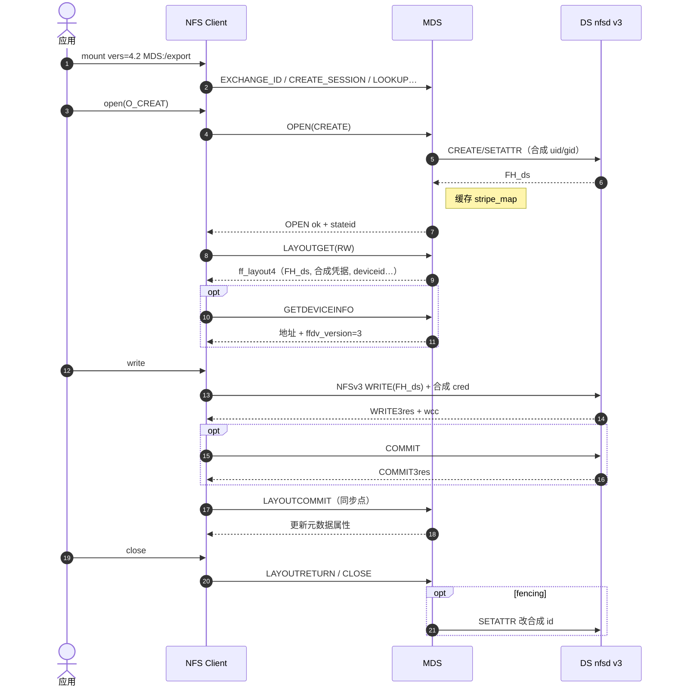

# pNFS Flexible File Layout（RFC 8435）与 Lattice 实现调研

> 整理范围：基于 RFC 8435 / RFC 8881（files layout）讨论要点，并结合 PEAK-AIO/pnfs-lattice 公开文档与实现观察。  
> 规范效力以 IETF 英文原文为准；本文为调研笔记，非协议替代。

---

## 1. 背景与问题

并行 NFS（pNFS）把 **元数据** 与 **数据 I/O** 分离：

- **MDS（Metadata Server）**：目录、属性、OPEN/CLOSE、发放/召回布局。
- **DS / 存储设备**：承载文件数据；客户端在持有布局后可直访。

传统「所有读写都打一台 NFS 服务器」时，MDS（或单一 NFS 节点）易成为带宽与 CPU 瓶颈。pNFS 通过布局类型（layout type）描述「数据在哪、用什么协议访问」。

常见布局类型：

| 类型 | 编号 | 规范 | 数据面 |
|------|------|------|--------|
| Files | 1 | RFC 8881 §13 | NFSv4.1+ 文件 DS |
| Objects | 2 | — | 对象存储 |
| Blocks | 3 | RFC 5663 等 | 块设备 |
| **Flex Files** | **4** | **RFC 8435** | NFSv3/4.x 文件 DS |
| SCSI | 5 | RFC 8154 + RFC 9561(NVMe) | SCSI/NVMe 块 |

本文聚焦 **Flex Files**，并与 **Files layout**、**Lattice** 对照。

---

## 2. RFC 8435 重要概念

### 2.1 布局（Layout）与布局段

- **Layout**：客户端访问文件数据所需信息（布局类型 + 设备标识 + 布局体）。
- **Layout segment**：按 iomode、条带或字节范围划分的一段布局。
- **Layout stateid**：标识某文件某布局类型的布局状态。
- **iomode**：`LAYOUTIOMODE4_READ` / `RW` 等。

Flex Files 的布局体核心是 `ff_layout4`：条带单元、镜像数组、标志位等。xiang每个镜像内可有多个 data server（条带）。

### 2.2 松耦合 vs 紧耦合

==「耦合」描述的是 **MDS 与 DS 之间** 有无专用控制面==，不是「客户端是否用 NFS」。

| | 松耦合（Loose） | 紧耦合（Tight） |
|--|-----------------|-----------------|
| 定义 | 控制协议 ≈ 存储协议（普通 NFS） | 另有控制协议同步状态 |
| MDS↔DS | 建文件、SETATTR、拿 FH；**不能**传全局 stateid | 可同步 stateid / 锁 / fencing |
| DS | 常为独立 knfsd / NFSv3 | NFSv4.1+ 且参与控制面 |
| 客户端→DS | FH + **合成 uid/gid**；NFSv4 DS 上多用 **匿名 stateid** | 与 MDS 一致的授权 / 全局 stateid |
| Fencing | 改 DS 上数据文件 owner/group，使旧凭据失效 | 使 DS 上 stateid 失效等 |

**为何「DS 用 NFS」实践上多为松耦合：**  
标准 NFS 导出不懂 pNFS 全局状态，MDS 只能当普通 NFS 客户端操作 DS；没有状态同步通道时，只能走松耦合模型。若另有控制协议且 `ffdv_tightly_coupled=true`，即使数据协议是 NFS，也可以是紧耦合（少见、需定制）。

### 2.3 合成 uid/gid 与隔离（Fencing）

松耦合下：

1. MDS 在 DS 上创建数据文件，并设置 **合成** uid/gid（非真实终端用户）。
2. LAYOUTGET 通过 `ffds_user` / `ffds_group` 告诉客户端：访问 DS 时 RPC 凭据用这对 id。
3. 需要隔离客户端时，MDS 对 DS 上文件 **SETATTR 改 owner/group**，旧凭据随之失效（常影响所有仍持旧凭据的客户端，粒度偏粗）。

注意：AUTH_SYS 下合成 id 为 0 应避免（易映射为 root 或匿名）。

### 2.4 匿名 stateid

- 定义于 **RFC 5661 / 8881 §8.2.3**（特殊 stateid）：`other` 与 `seqid` 全 0。
- 表示 I/O **不关联任何 OPEN 状态**。
- Flex Files **松耦合** 且 DS 为 NFSv4 时：客户端对 DS 须用匿名 stateid；布局里 `ffds_stateid` 亦须为匿名。
- **不得**用于对 data server 的特殊例外之外的误用场景；files 布局的 DS 路径则 **禁止** special stateid。

### 2.5 稀疏映射 vs 稠密映射

文件布局（RFC 8881 §13.4.4）支持两种打包；**Flex Files 仅支持稀疏映射**。

假设 3 个 DS、stripe unit = 4KB，轮转 DS1→DS2→DS3：

| 逻辑 stripe | 0 | 1 | 2 | 3 | 4 | 5 | … |
|-------------|---|---|---|---|---|---|---|
| 落到 | DS1 | DS2 | DS3 | DS1 | DS2 | DS3 | … |

- **稀疏（sparse）**：逻辑偏移 = 该 DS 上物理偏移；各 DS 文件在「不属于自己的 stripe」处为 **洞**。DS 需理解条带；误写洞可返回 `NFS4ERR_PNFS_IO_HOLE`。
- **稠密（dense）**：DS 上文件无洞，只紧凑存放本 DS 的 stripe；客户端须换算偏移。Flex Files **不做** dense。

Flex Files（RFC 8435 §6）：逻辑偏移 L 即存储设备上物理偏移。

### 2.6 镜像（Mirroring）与 `FF_FLAGS_WRITE_ONE_MIRROR`

- **镜像**：布局段的完整数据副本（`ffl_mirrors`）。
- **默认：客户端侧镜像**：读可选一副本；写须更新 layout 中展示的全部镜像（除非见下）。
- **`FF_FLAGS_WRITE_ONE_MIRROR`**：客户端只写一份，由 **存储侧** 扇出到其余镜像。普通 knfsd **做不到** 扇出，故 Lattice 类部署实质上走「客户端写全镜像」。

勿与下列概念混淆：

| 概念 | 问题 | 结构 |
|------|------|------|
| 条带并行 | 不同数据块去哪台 DS？ | 镜像内多个 DS / stripe |
| 镜像 | 同一内容几份副本？ | `ffl_mirrors` |
| 多路径 | 到 **同一 DS** 怎么走网？ | `ffda_netaddrs` |

### 2.7 多路径与 Trunking

- `ffda_netaddrs`：同一 deviceid 的多个网络地址。
- 用途：带宽（session/clientid trunking、`nconnect`）、故障切换；一般 **不要求** 再问 MDS 换 layout。
- **不是**「同一条带写到不同无关 DS」（那是镜像或配错）。
- 同一 DS 多连接时：单个 RPC 仍走一条连接；多个 WRITE RPC（如按 wsize 拆分）可分摊到多连接并发。

### 2.8 LAYOUTCOMMIT 与属性回传

松耦合下 DS 直写后，MDS **不会自动知道** 数据文件 size/mtime 等变化。

- **LAYOUTCOMMIT**：客户端在 close/fsync/归还布局等同步点，把新 size 等提交给 MDS（当前 Lattice 主路径）。
- **LAYOUT_WCC（RFC 9766）**：可选；客户端把 DS 上 NFSv3 WCC 属性更勤地报给 MDS，减少 MDS 对 DS 的 GETATTR。Lattice 公开树 **未实现**。

### 2.9 NFSv3 WCC（弱缓存一致性）简述

修改类操作返回 `before`（size/mtime/ctime）+ `after` 属性，帮助客户端判断「中间是否有别人改过」从而决定是否作废缓存。  
它是 **weak** 提示，不是强一致；读路径无 WCC、时间戳粒度粗、交错写无锁等场景仍可能不一致。

---

## 3. 概念示例

### 3.1 松耦合写一条带（示意）

1. 用户在 MDS 上 OPEN 逻辑文件 `/data/f`。  
2. MDS 在 DS0、DS1 上各建数据文件，抓取 **FH_ds**，设合成 uid/gid，记入 stripe map。  
3. LAYOUTGET 返回 `ff_layout4`（含 FH_ds、合成凭据、deviceid…）。  
4. 客户端对 DS0 发 NFSv3 WRITE(FH_ds, …)，凭据为合成 id。  
5. close 时 LAYOUTCOMMIT → MDS 更新逻辑文件 size；可选 LAYOUTRETURN。

### 3.2 镜像（mirror_count=2，无 WRITE_ONE_MIRROR）

- Layout 中两个 mirror，各指向不同 DS 上的完整副本。  
- 读：客户端可按 `ffds_efficiency` 选一个。  
- 写：客户端须向 **两个** mirror 都写成功（或报告错误供 MDS 修复）。

### 3.3 Fencing

MDS 将 DS 上数据文件 uid 从 `19452` 改为 `19453` 后，仍持旧凭据 `19452` 的客户端再写将得到 ACCESS 类错误，从而被隔离。

---

## 4. Files Layout vs Flex Files Layout

| 维度 | Files（RFC 8881 §13） | Flex Files（RFC 8435） |
|------|----------------------|-------------------------|
| 类型号 | 1 | 4 |
| DS 协议 | **必须** NFSv4.1+ pNFS DS | NFSv3 / 4.0 / 4.1 / 4.2 |
| MDS↔DS | 假定控制协议 + **全局 stateid** | 松耦合（合成 id）或可选紧耦合 |
| DS 上 stateid | OPEN/锁/委托 stateid（seqid=0）；禁 special | 松耦合：匿名 stateid |
| 打包 | 稀疏 + 稠密 | **仅稀疏** |
| 镜像 | 无一等公民镜像模型 | **`ffl_mirrors` + 客户端侧镜像** |
| 设备地址 | stripe_indices + multipath | netaddrs + **versions（含是否紧耦合）** |
| Fencing | 主要靠 stateid 失效 | 松耦合靠改合成 uid/gid |
| 设计目标 | 同族紧状态 NFSv4.1 DS 集群 | **普通 NFS 导出当 DS**，少/无定制控制协议 |

**一句话：** Files = 紧状态 NFSv4.1 DS；Flex = 可松耦合、可 NFSv3 DS、自带镜像语义。

---

## 5. pNFS I/O 流程（Flex Files 松耦合 + knfsd v3）

角色：应用、NFS Client（flexfiles）、MDS、DS（nfsd v3）。

### 5.1 挂载

- 用户 **只挂 MDS**：`mount -t nfs -o vers=4.2 MDS:/export /mnt`。  
- **不要**对每个 DS 再做用户态 mount。  
- Flex Files 驱动：`nfs_layout_flexfiles`；Files：`nfs_layout_nfsv41_files`。  
- `nconnect` 等可影响 MDS/DS 连接数，非「专用 pnfs=」开关。

### 5.2 端到端时序（创建 + 写 + 提交）

### 5.3 三条边职责

| 边 | 协议 | 内容 |
|----|------|------|
| Client ↔ MDS | NFSv4.2 | 命名空间、OPEN/CLOSE、LAYOUT*、GETDEVICEINFO |
| MDS ↔ DS | MDS 作 NFSv3 客户端 | 建数据文件、抓 FH、合成 owner、fencing、GC |
| Client ↔ DS | NFSv3 | 真正的 READ/WRITE/COMMIT；FH 来自 layout |

**FH 来源：** MDS **从 DS** CREATE/LOOKUP 捕获，再放入 `ff_layout4`；不是 MDS 凭空生成。

### 5.4 性能直觉

- **重：** 首次建文件/LAYOUTGET（MDS 访问 DS、记 map）、召回冲突、短命文件 churn。  
- **轻：** 已持有 layout 后的大数据 I/O（Client→DS，MDS 不参与）。  
- **适合：** 大文件、布局命中率高、高吞吐并行。  
- **慎用：** 海量小文件 create/delete、频繁布局冲突召回。  
- 多客户端 **可以**；痛点是冲突 RW 导致召回，而非「禁止多客户端」。

---

## 6. Lattice pNFS 实现要点

参考：[PEAK-AIO/pnfs-lattice](https://github.com/PEAK-AIO/pnfs-lattice) 公开 README / architecture / config。

### 6.1 定位

- 用户态 **MDS**：NFSv4.2 + **Flex Files（默认）**，亦可宣称支持 Files layout（NFSv4.1 DS）。  
- **DS**：标准未打补丁 **Linux knfsd**（典型 NFSv3 松耦合）。  
- 元数据权威：RonDB / FDB / DAOS / memdb 等可插拔 catalogue；多 MDS active-active + `fs_locations`。

### 6.2 与 RFC 8435 的符合性（摘要）

| 能力 | Lattice |
|------|---------|
| LAYOUTGET/RETURN/COMMIT、GETDEVICEINFO、CB_LAYOUTRECALL | 支持 |
| 松耦合 + NFSv3 DS | **主路径** |
| 合成 uid/gid | `ds_synth_owner` / `ds_synth_secret_file` 等 |
| 稀疏条带 + mirror_count | `default_stripe_count` / `default_mirror_count` |
| 多镜像写入 | 客户端写多副本；**非** WRITE_ONE_MIRROR 扇出 |
| 紧耦合控制协议 | 非 knfsd 主路径 |
| LAYOUT_WCC（RFC 9766） | **未实现**；属性靠 LAYOUTCOMMIT（及 LAYOUTSTATS） |
| TCP/RDMA 设备地址 | GETDEVICEINFO 可广告 |

### 6.3 协议外扩展（节选）

- 多 MDS + 共享 catalogue；DS 预分配、layout cache、DS GC、小文件 inline。  
- HPC-Shared（N-to-1 宽条带）、`hpc_xdr_form`（LEGACY vs STRIPED 线格式）。  
- `FF_FLAGS_STRIPE_LEASE`（非 8435 标准标志）等。

### 6.4 线格式注意（条带 vs 镜像）

- **LEGACY**：常用「一 mirror 一 DS」编码条带（wire 形状像多 mirror，语义可能是条带）。  
- **STRIPED**：一 mirror 内多 DS = 真正条带。  
- 真正冗余看 `mirror_count > 1`；勿把 LEGACY 的「多 mirror」一律当成数据镜像。

### 6.5 与 SCSI/NVMe 布局（RFC 9561）对比选型

| | Lattice Flex Files | knfsd SCSI + NVMe（9561） |
|--|--------------------|---------------------------|
| 数据面 | Client→NFS DS | Client→块/NVMe 直访 |
| 本地盘横向扩展 | 各节点当 DS，易吃满多机 | knfsd：**单卷**，文档不支持多 LUN 条带 |
| 共享 SAN 多客户端直打 | 可，但经 NFS | 适合；单 I/O 开销更低 |
| 内核 | 客户端 flexfiles（4.2） | NVMe 识别约 **≥ 6.11** |

三节点本地 NVMe：更贴 Lattice。  
三台共享盘阵 + 完整多卷条带 MDS：SCSI 布局协议可描述；**Linux knfsd 尚不能**靠 layout 条带三 LUN。

---

## 7. AI 存储场景与 pNFS 适用性

| 场景 | 访问形态 | Flex/pNFS |
|------|----------|-----------|
| 训练样本并行读 | 大文件、多客户端读 | **较适合** |
| Checkpoint / 大权重 | 大文件突发写 | **较适合**（布局能挂住） |
| 模型仓库拉取 | 读多写少 | **较适合** |
| 海量小文件 / Shuffle 临时文件 | 元数据风暴 | **不适合** |
| Notebook 家目录 | 小文件随机 | **不适合** |

训练阶段通常需要能容纳 **数据集 + 多版 checkpoint** 的大容量（或大容量对象存储后端）；pNFS 解决的是并行 POSIX 吞吐，不是「有没有容量」本身。

---

## 8. 相关 RFC 速查

| RFC | 内容 |
|-----|------|
| 8435 | Flexible File Layout |
| 8434 | pNFS Layout Types 要求 |
| 8881 | NFSv4.1（含 Files layout；取代 5661） |
| 7862 | NFSv4.2（LAYOUTERROR/STATS 等） |
| 1813 | NFSv3（含 WCC） |
| 9766 | LAYOUT_WCC（Flex + v3 WCC 上报 MDS） |
| 8154 / 9561 | SCSI 布局 / NVMe 映射 |

中文精译（本仓库）：`zh/rfc8435-zh.md`、`zh/rfc8881-zh.md`、`zh/rfc8434-zh.md` 等。

---

## 9. 结论摘要

1. Flex Files 让 **普通 NFS DS** 接入 pNFS，松耦合靠 **合成凭据 + 匿名 stateid + LAYOUTCOMMIT**。  
2. 数据面卸到 DS 后，收益来自大文件与高布局命中；怕的是 layout/元数据 churn。  
3. Lattice 是松耦合 Flex Files MDS 的工程实现；镜像默认客户端多写；无 LAYOUT_WCC。  
4. Files vs Flex：紧状态 v4.1 DS vs 可 v3 松耦合 + 一等公民镜像。  
5. 多路径 ≠ 条带 ≠ 镜像；SCSI/NVMe 布局解决共享块直访，与「本地盘横向扩展」问题域不同。

---

*文档版本：根据 2026-10～11 内部讨论整理。*
