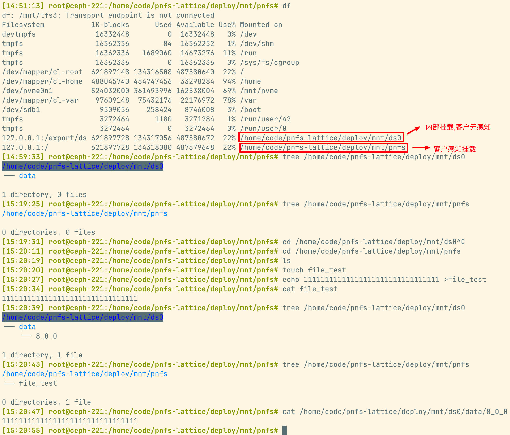
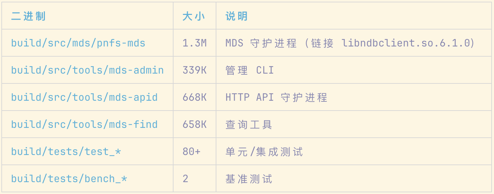

---
领域:
  - 协议
版本:
  - NA
状态:
  - 进行中
开发人员:
  - 刘乃朋
年份:
  - "2026"
imageNameKey: pnfs调研
tags:
  - LN技术评估
  - pnfs
---

# 1 pnfs  
pNFS（Parallel NFS，并行 NFS）,是 **NFSv4.1（RFC5661）原生标准扩展**，核心思想：**元数据路径和数据路径分离**，客户端拿到 layout 之后，可以绕过 NFS 元数据服务器，**直接并行访问后端存储节点**，解决传统 NFS 单服务器转发数据的瓶颈。

## 1.1 传统 NFS vs pNFS

- **普通 NFS**：所有读写数据流都经过 NFS 服务端，服务端成为带宽 / CPU 单点瓶颈
- **pNFS**：
    1. 元数据操作（open、stat、create、unlink、rename）走 MDS（元数据服务器）
    2. 客户端调用 `LAYOUTGET`，从 MDS 获取 **layout**（文件在后端存储的分片映射、权限 stateid、设备地址）
    3. 客户端直接和 Data Server / 块设备 / 对象存储通信读写数据，**数据不经过 MDS**
    4. MDS 可以随时 `LAYOUTRECALL` 收回 layout（比如文件元数据变更、truncate、删除、权限变动），强制客户端切回 MDS 通路

| Layout 类型                       | 编号 | 后端存储             | 说明                                                |
|---------------------------------|----|------------------|---------------------------------------------------|
| File Layout                     | 1  | 多台 NFS 数据服务器     | 文件条带分布在多个 NFS 节点，最经典；nfs-ganesha、NetApp、PanFS 常用  |
| Object Layout                   | 2  | OSD 对象存储         | OSD 协议，Ceph 早期原型思路，工业落地很少                         |
| Block Layout                    | 3  | 共享块存储 (iSCSI/FC) | 客户端直接读写块；Linux 内核 NFS 服务端 + XFS 支持；需要客户端可直连共享 LUN |
| Flexible File Layout(FlexFiles) | -  | 增强版 File Layout  | RFC8435，支持镜像、纠删、故障分片修复，现在主流新实现都用这个                |
## 1.2 关键流程（一次写）
1. Client → MDS：`OPEN` / `CREATE` 创建文件（元数据走 MDS）
2. Client → MDS：`LAYOUTGET`，请求文件布局
3. MDS 返回 layout：offset、长度、设备列表、stateid、条带信息
4. Client → 多个 Data Server：直接并行 WRITE（不走 MDS）
5. 发生元数据变更（unlink、rename、setattr）：MDS 发 `LAYOUTRECALL`，客户端停止直写，交还 layout，后续 IO 切回 MDS
6. Client 完成：`LAYOUTRETURN` 归还布局

## 1.3 重要核心概念
- **Layout**：文件到底层存储的地址映射 + 访问凭证（stateid），有有效期，可以被召回
- **Layout Recall**：MDS 强控手段，是 pNFS 一致性的关键；压测（fsstress）很多 bug 都出在 recall 竞争、layout 泄漏、IO 悬挂
- **Stateid**：pNFS 权限句柄，绑定 layout，防止越权访问数据设备
- **DS（Data Server）**：数据节点，只负责数据读写，不处理元数据

## 1.4 优缺点

✅ 优势
- 带宽横向扩展：多客户端、多 DS 并行 IO，适合 HPC、AI 大文件流式读写
- MDS 只处理元数据，CPU、网卡不再被数据流占满
- 兼容标准 NFS 语义，上层应用无需修改代码

❌ 代价
- 网络拓扑更复杂：客户端需要同时连通 MDS + 全部 DS
- 一致性逻辑变复杂：Layout Recall、IO 悬停、回收竞争是高频故障点
- 运维排障难：IO 可能走两条路径；抓包需要同时看 MDS 和 DS 流量
- 小 IO、频繁元数据操作场景收益不大（你前面那条 creat/write/unlink 小 IO workload，就是专门打元数据 + recall 路径）
# 2 pNFS-Lattice  
项目官网：  
1. [https://pnfs-lattice.org](https://link.wtturl.cn/?target=https%3A%2F%2Fpnfs-lattice.org&scene=im&aid=582478&lang=zh) 
2. [https://pnfs-hydra.io](https://link.wtturl.cn/?target=https%3A%2F%2Fpnfs-hydra.io&scene=im&aid=582478&lang=zh)
3. https://github.com/PEAK-AIO/pnfs-lattice  

由 PEAK:AIO + LANL（洛斯阿拉莫斯国家实验室）联合主导、Linux Foundation 下开源的新一代 **pNFS 元数据服务（MDS）项目**，定位：**弹性、可水平扩缩容、无单点的 pNFS MDS**，专门解决传统 pNFS MDS 元数据瓶颈问题，面向 AI / HPC 大集群场景

- **nfs-ganesha**：完整 NFS/pNFS 服务端（协议栈 + MDS + FSAL 对接后端存储），MDS 实例是有状态的、静态部署；集群方案靠外部分布式存储承接元数据
- **Lattice**：**只做弹性 MDS（元数据平面）**，原生设计目标是把 MDS 本身做成无状态、可随时启停、上千节点弹性扩缩的 “元数据集群”；**不负责 Data Server**，兼容标准 NFSv4.2 pNFS FlexFile Layout v2，DS 可以复用现有 ganesha DS 或者其他 pNFS Data Server

## 2.1 系统架构  
### 2.1.1 架构图
```bash
       ┌──────────────────────────────────────────┐
       │        MDS Cluster (active-active)        │
       │  ┌────────┐  ┌────────┐  ┌────────┐     │
       │  │ MDS-0  │  │ MDS-1  │  │ MDS-N  │     │
       │  └───┬────┘  └───┬────┘  └───┬────┘     │
       │      └───────────┼───────────┘           │
       └──────────────────┼───────────────────────┘
                          │ NDB C++ API
            ┌─────────────┴─────────────┐
            │     RonDB Cluster          │
            │  (共享元数据存储)            │
            │  inodes · dirents · stripe  │
            │  ds_registry · node_reg     │
            └─────────────┬─────────────┘
                          │
       ┌──────────────────┼──────────────────┐
┌──────▼──────┐   ┌──────▼──────┐   ┌───────▼──────┐
│  NFS DS-0   │   │  NFS DS-1   │   │  NFS DS-N    │
│flex TCP/RDMA│   │flex TCP/RDMA│   │flex TCP/RDMA  │
└─────────────┘   └─────────────┘   └──────────────┘
```

**三层分离设计**:
1. **MDS 层** — 元数据协调，active-active 多节点
2. **Catalogue 层** — 分布式事务元数据存储（RonDB/FoundationDB/DAOS/memdb）
3. **DS 层** — 标准 Linux knfsd，存储实际数据块
### 2.1.2 概念说明  
#### 2.1.2.1 MDS 空间 = 命名空间（Namespace）

每个 MDS 管理的是**命名空间的一个子树**，包括：

|内容|说明|
|---|---|
|目录树结构|文件/目录的层级关系|
|文件属性|权限、属主、大小、时间戳等|
|inode 元数据|文件标识符、链接计数等|
|Layout 映射|文件数据分布在哪些 DS 上|

在多 MDS 架构中，全局命名空间通过 **subtree map**（子树映射）被分割：  
```bash
/（全局根）
├── referral → MDS-1 管理的子树（如 /home/user1/）
├── referral → MDS-2 管理的子树（如 /home/user2/）
└── referral → MDS-3 管理的子树（如 /data/project/）
```

所有 MDS 通过 **RonDB**（分布式数据库）共享元数据，任何一个 MDS 都能看到全局命名空间，但每个 MDS 主要"负责"一个子树的所有权。  

##### 2.1.2.1.1 Shard和MDS的对应关系  
1. 每个 Shard 对应一个 MDS, 每个 shard 通过 referral 指向拥有它的 MDS, 比如：
```bash
/shard1  →  referral to MDS-1 (10.10.10.50)
/shard2  →  referral to MDS-2 (10.10.10.51)
/shard3  →  referral to MDS-3 (10.10.10.55)
```
从 `subtree_map.h `可以看到：

```c
struct subtree_entry {
    char                path[MDS_MAX_PATH];    // 如 "/shard1"
    uint32_t            owner_mds_id;          // 拥有的 MDS ID
    // ...
};
```

2. Shard 里面的操作默认只会落到这个 MDS 上

| 配置项             | 默认值   | 行为                                                                              |
|-----------------|-------|---------------------------------------------------------------------------------|
| referral_strict | true  | 操作会检查 filehandle 的 owner_mds_id，如果不是当前 MDS，返回 NFS4ERR_MOVED，强制客户端跳转到 owning MDS |
| referral_strict | false | 历史模式（serve-anywhere），任何 MDS 都可以处理任何操作                                           |
从 `compound_namespace.c`：
```c
if (subtree_map_lookup_exact(cd->smap, jpath, &se) == MDS_OK &&
    se.owner_mds_id != cd->mds_id) {
    return NFS4ERR_MOVED;  // 强制跳转到 owning MDS
}
```

3. Shard 内部会继续分片， 但需要手动或自动触发 split
```c
// 可以将 /data 分片为 /data/users、/data/projects 等子分片
enum mds_status subtree_split_execute(
    struct subtree_map *map,
    struct mds_catalogue *cat,
    const char *parent_path,    // "/data"
    const char *child_path,     // "/data/users"
    uint64_t child_fileid,
    uint32_t dest_mds_id,       // 可以分配给不同的 MDS
    // ...
);
```

**分片层级示例**：
```txt
/ (root)
├── /shard1 (MDS-1)
│   ├── /shard1/users (MDS-1) ← 可以进一步分片
│   └── /shard1/projects (MDS-2) ← 迁移到其他 MDS
├── /shard2 (MDS-2)
└── /shard3 (MDS-3)
```

**但通常不会自动递归分片**，分片是按需进行的（负载均衡或数据局部性优化）。  

#### 2.1.2.2 数据空间 = DS 的本地存储  
数据空间是**每个 DS 独立的本地存储**，不是多节点共享的：  
```bash
DS-1 (192.168.100.52)          DS-2 (192.168.100.53)
┌─────────────────────┐        ┌─────────────────────┐
│ /export/ds/         │        │ /export/ds/         │
│   data/             │        │   data/             │
│     5_0_0  (inode5) │        │     6_0_0  (inode6) │
│     7_0_0  (inode7) │        │     8_1_0  (inode8) │
└─────────────────────┘        └─────────────────────┘
       本地存储                       本地存储
```
**关键特征：**

| 特征         | 说明                                       |
| ---------- | ---------------------------------------- |
| **物理分布**   | 每个 DS 有自己的磁盘，数据文件存储在本地                   |
| **数据分散**   | 文件按 `inode_stripe_mirror` 格式分散存储在不同 DS 上 |
| **MDS 可见** | 所有 MDS 通过 NFS 挂载可以访问所有 DS 的数据            |
| **客户端直访**  | pNFS 客户端通过 Layout 直接访问 DS，不经过 MDS        |
### 2.1.3 源码模块结构  
| 目录               | 职责               | 核心文件                                                              |
| ---------------- | ---------------- | ----------------------------------------------------------------- |
| `src/mds/`       | NFSv4.1/4.2 协议处理 | compound.c (调度器), rpc_server.c, main.c                            |
| `src/catalogue/` | 可插拔元数据后端         | catalogue_rondb_shim.cpp, catalogue_memdb.c, catalogue_dispatch.c |
| `src/cluster/`   | MDS 间协调          | cluster_transport.c, rename_2pc.c, failover.c                     |
| `src/fsal_obj/`  | FSAL 对象抽象        | layout.c, placement.c                                             |
| `src/common/`    | 共享基础设施           | config.c, log.c, threadpool.c                                     |
| `src/tools/`     | CLI 工具           | mds-admin, mds-find, mds-apid, mds-backend-probe                  |
| `src/modules/`   | 可选模块             | ds_gc, ds_prealloc, layout_cache, observability 等                 |
| `include/`       | 公共 C 头文件         | 90+ 头文件，每个子系统一个                                                   |
| `tests/`         | 测试套件             | 82 个单元测试 + 集成测试 + 一致性测试                                           |
### 2.1.4 元数据分布  
元数据分布机制回答的核心问题是：**元数据如何在 MDS、DS、客户端三者之间产生、流转、同步和回收**。以下按生命周期阶段展开。
#### 2.1.4.1 元数据产生机制：DS 放置（Placement）  
当客户端首次对文件发起 LAYOUTGET 时，MDS 需要决定该文件的条带映射——即数据分布在哪些 DS 上。这是元数据分布的**起点**。  

```txt
┌─────────────────────────────────────────────────────────────────┐
│  LAYOUTGET 触发 DS 放置决策                                       │
│                                                                 │
│  1. 读取 DS 注册表 (ds_cache → ds_registry)                      │
│     → 过滤 ONLINE + 兼容 mode/transport 的 DS 集合                │
│                                                                 │
│  2. 选择放置策略 (placement_policy_enabled ? 配置策略 : RR)        │
│     ┌──────────────────────────────────────────────────────┐     │
│     │ PLACEMENT_RR          : 全局原子计数器轮转              │     │
│     │ PLACEMENT_WEIGHTED_RR : 加权蓄水池 (total - used)      │     │
│     │ PLACEMENT_CAPACITY    : 最大空闲 DS 优先               │     │
│     └──────────────────────────────────────────────────────┘     │
│                                                                 │
│  3. 核心分配公式:                                                 │
│     ds_idx = (start_key + s * mirror_count + m) % online_count   │
│     其中 start_key = fileid (使不同文件均匀散布)                    │
│     约束: 同一 stripe 的不同 mirror 不在同一 DS                     │
│                                                                 │
│  4. 降级处理 (placement_select2):                                  │
│     请求 stripe_count > ONLINE DS 数 → 缩减到实际可用数            │
│     返回 effective_stripe_count (调用方必须用此值持久化)             │
│                                                                 │
│  5. 持久化: cat_stripe_map_put(header) + cat_stripe_map_put(entries)│
│     → 写入 mds_stripe_maps + mds_stripe_entries 表                │
└─────────────────────────────────────────────────────────────────┘
```
**放置结果即元数据分布的物理映射**：一个 `stripe_count × mirror_count` 的矩阵，每个条目记录 `(ds_id, nfs_fh)`。  
#### 2.1.4.2 元数据写入机制  
元数据修改不是直接写后端，而是经过一个分层管道：
```bash
┌──────────────────────────────────────────────────────────────────┐
│  RPC 工作线程                                                     │
│  (compound_layoutget / op_open / op_create / ...)                │
│       │                                                          │
│       ▼                                                          │
│  ┌──────────────────────────────────────────────────────────┐    │
│  │  Layer 1: 内存写（即时生效）                                 │    │
│  │                                                          │    │
│  │  open_state_table → 本地 hash 表插入                       │    │
│  │  layout_cache     → LRU 缓存 put                          │    │
│  │  deleg_table      → 本地 hash 表插入                       │    │
│  │  stripe_lease_table → 租约获取                             │    │
│  │                                                          │    │
│  │  效果: 本 MDS 立即可见；其他 MDS 不可见                      │    │
│  └──────────────────────┬───────────────────────────────────┘    │
│                         │ write-through                          │
│                         ▼                                        │
│  ┌──────────────────────────────────────────────────────────┐    │
│  │  Layer 2: Commit Queue（批量提交管道）                       │    │
│  │                                                          │    │
│  │  commit_queue_submit(op) → 不可变操作描述符入队              │    │
│  │  写入线程: 攒批 (≤128 ops 或 ≤1MiB 或 ≤2ms)                │    │
│  │  → 通过 catalogue vtable 分发到后端                         │    │
│  │  → 可选: 通过 repl_conn 复制到 Standby MDS                  │    │
│  │                                                          │    │
│  │  核心不变量: NFS 回复不先于 catalogue 写入发送                │    │
│  └──────────────────────┬───────────────────────────────────┘    │
│                         │                                        │
│                         ▼                                        │
│  ┌──────────────────────────────────────────────────────────┐    │
│  │  Layer 3: Catalogue 后端（共享持久化）                       │    │
│  │                                                          │    │
│  │  RonDB: 单行自提交 (每个 cat_* 调用独立原子提交)              │    │
│  │  Fused 操作: 多行单事务 (ns_create_wide, layoutget_fused)   │    │
│  │                                                          │    │
│  │  效果: 所有 MDS 立即可见（RonDB 分布式一致性）               │    │
│  └──────────────────────────────────────────────────────────┘    │
└──────────────────────────────────────────────────────────────────┘
```

**关键机制**：

- `transient_state_cache=true` 时跳过 Layer 2/3，内存即权威（单 MDS 安全）
- `transient_state_cache=false` 时 write-through 到 RonDB（多 MDS 必须）
- Fused 操作（如 `ns_create_with_layout`、`layoutget_fused`）在单后端事务中完成多行原子写入
#### 2.1.4.3 跨 MDS 元数据同步机制  
多 MDS 部署下，元数据如何在节点间保持一致？  
```txt
┌──────────────────────────────────────────────────────────────────┐
│               跨 MDS 元数据同步架构                                │
│                                                                  │
│   ┌────────────────────────────────────────────────────────┐     │
│   │  机制 A: 共享 Catalogue（主路径）                         │     │
│   │                                                        │     │
│   │  RonDB/FDB/DAOS 作为唯一权威 (shared authority)          │     │
│   │  所有 MDS 直接读写同一后端                                │     │
│   │  → inode/dirent/stripe_map/ds_registry 天然一致          │     │
│   │  → layout_state/open_state/delegation 通过协调表共享      │     │
│   └────────────────────────────────────────────────────────┘     │
│                                                                  │
│   ┌────────────────────────────────────────────────────────┐     │
│   │  机制 B: Delta Broadcast + Catalog Image（加速路径）      │     │
│   │                                                        │     │
│   │  每次 catalogue 写操作产生一条 delta 记录:                 │     │
│   │    (stream_id=MDS_id, seqno=单调递增, type, payload)     │     │
│   │                                                        │     │
│   │  写入 mds_delta_broadcast 表 ──► 其他 MDS 的 poller       │     │
│   │  定期轮询 ──► catalog_image_apply(delta)                  │     │
│   │  ──► 内存 image 逐步追上 authority                        │     │
│   │                                                        │     │
│   │  四种生命周期模式:                                        │     │
│   │    OFF     : 无 image，全部读 authority                    │     │
│   │    SHADOW  : image 回放但回复来自 authority                 │     │
│   │    COMPARE : 热读比较 image vs authority                   │     │
│   │    PRIMARY : 热读 image，失败回退 authority                 │     │
│   └────────────────────────────────────────────────────────┘     │
│                                                                  │
│   ┌────────────────────────────────────────────────────────┐     │
│   │  机制 C: 2PC Journal（跨 MDS 操作）                       │     │
│   │                                                        │     │
│   │  跨分片 RENAME / HARDLINK 需要两阶段提交:                  │     │
│   │                                                        │     │
│   │  Phase 1 (PREPARE):                                    │     │
│   │    协调方写 mds_rename_journal(PREPARED)                  │     │
│   │    参与方写 mds_rename_journal(PREPARED)                  │     │
│   │    获取分布式锁 (mds_ns_locks, 按 class 排序避免死锁)      │     │
│   │                                                        │     │
│   │  Phase 2 (COMMIT):                                     │     │
│   │    协调方执行本地操作 → journal(COMMITTED)                 │     │
│   │    通知参与方执行 → journal(COMMITTED)                     │     │
│   │    释放分布式锁                                           │     │
│   │                                                        │     │
│   │  崩溃恢复: 启动时扫描 journal, PREPARED → ABORTED          │     │
│   └────────────────────────────────────────────────────────┘     │
└──────────────────────────────────────────────────────────────────┘
```

#### 2.1.4.4 分片路由机制：操作如何落到正确的 MDS  
多 MDS 部署中，命名空间被分成多个 shard（分片），每个 shard 由一个 MDS 拥有：  
home_shard_id 嵌入在 inode 的 RonDB 行中（`rondb_schema.c `），使得单次 inode 读即可完成路由判断。
```txt
┌──────────────────────────────────────────────────────────────────┐
│  分片路由流程                                                      │
│                                                                  │
│  1. 客户端 PUTFH(filehandle)                                      │
│     │                                                            │
│     ▼                                                            │
│  2. MDS 从 FH 提取 fileid → 查 mds_shard_fileid 表                │
│     → 得到 home_shard_id (inode 行中存储)                          │
│     │                                                            │
│     ▼                                                            │
│  3. 查 subtree_map: home_shard_id → owner_mds_id                  │
│     │                                                            │
│     ├── owner_mds_id == self → 正常处理                            │
│     │                                                            │
│     └── owner_mds_id != self (referral_strict=true):              │
│         → 返回 NFS4ERR_MOVED                                      │
│         → 客户端根据 fs_locations referral 重新连接到正确 MDS       │
│                                                                  │
│  4. 跨分片 LOOKUP:                                                │
│     本地 dirent 不存在 → 查 mds_ext_dirents 表                     │
│     → 获得 (owner_mds_id, target_fileid, anchor_id)               │
│     → 返回 referral 给客户端                                      │
└──────────────────────────────────────────────────────────────────┘
```

#### 2.1.4.5 元数据缓存一致性机制  
内存缓存与共享 Catalogue 之间的一致性维护：  

| 缓存                 | 写入策略                              | 失效触发                                  | 一致性保证                                    |
|--------------------|-----------------------------------|---------------------------------------|------------------------------------------|
| layout_cache       | LAYOUTGET 命中时 put                 | remove / setattr(shrink) 时 invalidate | 最终一致；HPC-Shared 文件 stripe_map 生命周期内稳定    |
| open_state_table   | open/close 时本地写 + write-through   | CLOSE / lease 过期 / 崩溃恢复               | shared_state_supported 时 RonDB 权威；否则内存权威 |
| deleg_table        | grant/return 时本地写 + write-through | recall / revoke / file unlink         | 同上                                       |
| session_table      | EXCHANGE_ID/CREATE_SESSION 时本地写   | lease 过期 / DESTROY_SESSION            | 内存权威（clientid 按 MDS 隔离）                  |
| ds_cache           | 启动时全量加载 + 管理员命令时 reload           | ds add/remove/set-state/provision     | 启动时一致；管理员操作后显式刷新                         |
| stripe_lease_table | 纯内存，不持久化                          | lease 过期 / LAYOUTRETURN               | 单 MDS 内存权威                               |
transient_state_cache 开关（`pnfs_mds.h`）：
- false（默认）：open/delegation/lock 状态 write-through 到 RonDB，多 MDS 安全
- true：仅内存，单 MDS 部署优化，崩溃后客户端通过 reclaim 重建
#### 2.1.4.6 元数据回收机制  
元数据不会永久驻留，以下机制负责回收：  
```txt
┌──────────────────────────────────────────────────────────────────┐
│  元数据回收路径                                                     │
│                                                                  │
│  A. GC 队列 (ds_gc)                                               │
│     触发: 文件最终 unlink (nlink→0)                                │
│     流程: gc_enqueue(fileid, ds_id, nfs_fh, sweep_hint)           │
│           → mds_gc_queue 表                                       │
│           → GC worker 线程 peek_batch → proxy unlink DS 文件       │
│           → gc_dequeue                                            │
│     并行: ds_gc_workers 个 worker 并行消费                          │
│     分布: 每个 MDS 只 drain 自己 owner_mds_id 的行                   │
│     sweep_hint: 告诉 worker 清理哪些 (stripe,mirror) 文件            │
│                                                                  │
│  B. 异步删除清单 (remove_pending)                                   │
│     触发: remove_async=true 时的 unlink                            │
│     流程: enqueue_unlink(dirent + inode guard)                     │
│           → 立即删除 dirent (快速回复客户端)                          │
│           → 后台 worker claim → 执行 DS 清理 → 删除 inode            │
│     优势: 将 DS 对象清理从 unlink 热路径移出                          │
│                                                                  │
│  C. Layout state 回收                                              │
│     触发: LAYOUTRETURN / CB_LAYOUTRECALL / DS 故障 / lease 过期      │
│     流程: layout_return → layout_state 行删除 + ds_layout_idx 删除   │
│           → stripe_lease_release_all_for                            │
│                                                                  │
│  D. Session/Open/Delegation 回收                                   │
│     触发: lease 过期 (session_table_start_reaper)                   │
│     流程: open_state_close_all_for_client                           │
│           → deleg_revoke_client                                     │
│           → session_destroy_client                                  │
│           → 可选: DS fencing (proxy chown 中立 uid)                  │
│                                                                  │
│  E. 客户端恢复记录回收                                               │
│     触发: RECLAIM_COMPLETE 后                                       │
│     流程: mds_coord_recovery_del(clientid)                          │
└──────────────────────────────────────────────────────────────────┘
```

#### 2.1.4.7 元数据重分布机制：Rebalance & Resilver  
当 DS 拓扑变化（故障、扩容、均衡）时，元数据需要重新映射：  

```txt
┌──────────────────────────────────────────────────────────────────┐
│  Rebalance (管理员触发, 镜像搬迁)                                    │
│                                                                  │
│  场景: 将 DS-A 上的镜像数据迁移到 DS-B                               │
│  约束: 单 stripe 文件, 无活跃 layout/writer, dense 文件             │
│                                                                  │
│  流程:                                                           │
│  1. scan: cat_stripe_map_scan → 找到 DS-A 上的文件                  │
│  2. 检查: open_state(无活跃 writer) + layout_state(无活跃 layout)   │
│  3. copy: proxy_read(DS-A) → proxy_write(DS-B)                   │
│  4. atomic swap: stripe_map_put(新 DS-B entry)                    │
│                + gc_enqueue(旧 DS-A entry)                        │
│     → 通过 commit_queue 或 rebalance_move 单事务完成                 │
│  5. 重复直到所有候选处理完毕                                          │
├──────────────────────────────────────────────────────────────────┤
│  Resilver (管理员触发, 降级修复)                                      │
│                                                                  │
│  场景: DS-A 故障后, 从其健康镜像副本重建到替换 DS-B                     │
│  约束: 同上                                                        │
│                                                                  │
│  流程:                                                           │
│  1. scan: 找到所有 degraded mirror 的文件                           │
│  2. 从健康 mirror 读取数据                                           │
│  3. 写入 target_ds                                                  │
│  4. 更新 stripe_map + gc_enqueue 旧条目                              │
│  5. placement_select_replacement 选择替换 DS                         │
├──────────────────────────────────────────────────────────────────┤
│  DS 故障时的元数据连锁反应                                            │
│                                                                  │
│  ds_health_monitor 检测到 DS 连续失败                                 │
│  → ds_registry.state = DS_OFFLINE (通过 commit_queue 复制)          │
│  → ds_fail_cb 回调触发                                             │
│  → layout_recall_for_ds():                                        │
│    1. ds_layout_idx_scan(ds_id) → 收集所有 (clientid, fileid)       │
│    2. 对每个唯一 clientid 发送 CB_LAYOUTRECALL(ALL)                  │
│    3. 强制撤销所有受影响的 layout_state 行                            │
│  → ds_cache_invalidate() 刷新本地缓存                               │
│  → 后续 LAYOUTGET 不再选择该 DS (placement 过滤 OFFLINE)              │
└──────────────────────────────────────────────────────────────────┘
```

#### 2.1.4.8 Device ID 编码机制：元数据寻址桥梁  
Device ID 是连接**逻辑元数据**和**物理 DS 地址**的桥梁：  
```txt
┌──────────────────────────────────────────────────────────────────┐
│  Device ID 结构 (16 bytes)                                        │
│  ┌──────────────┬──────────────┬───────────────┬──────────────┐  │
│  │ mds_id (4B)  │ ds_id (4B)   │io_generation  │ zeros (4B)   │  │
│  │ Big-Endian   │ Big-Endian   │  (4B) BE      │              │  │
│  └──────────────┴──────────────┴───────────────┴──────────────┘  │
│                                                                  │
│  编码: build_deviceid(mds_id, ds_id, io_generation)               │
│  解码: deviceid_to_ds_id(deviceid) → ds_id                        │
│                                                                  │
│  用途:                                                           │
│  ┌─────────────────────────────────────────────────────────┐     │
│  │  LAYOUTGET 响应:                                         │     │
│  │    ff_data_server4.deviceid = build_deviceid(...)         │     │
│  │    → 客户端收到 deviceid                                  │     │
│  │                                                         │     │
│  │  GETDEVICEINFO 请求:                                     │     │
│  │    客户端发送 deviceid                                    │     │
│  │    MDS 解码 → ds_id → 查 ds_cache → 返回 host/port/...   │     │
│  └─────────────────────────────────────────────────────────┘     │
│                                                                  │
│  io_generation: DS 重新注册时递增, 使旧 deviceid 失效               │
│  客户端缓存旧 deviceid 的 GETDEVICEINFO 结果 → 下次发现 generation   │
│  不匹配 → 重新 GETDEVICEINFO                                       │
└──────────────────────────────────────────────────────────────────┘
```

#### 2.1.4.9 Delta 记录机制：元数据变更追踪  
每次 Catalogue 写操作都会产生语义化的 delta 记录（`catalog_delta.h`）：  
```bash
┌──────────────────────────────────────────────────────────────────┐
│  Delta 记录格式 (25 字节头 + 变长 payload)                          │
│                                                                  │
│  type(1B) + stream_id(4B) + seqno(8B) + timestamp_ns(8B)         │
│  + payload_len(4B) + payload(变长)                                 │
│                                                                  │
│  22 种语义类型:                                                     │
│  INODE_UPSERT / INODE_DELETE / DIRENT_PUT / DIRENT_DELETE         │
│  STRIPE_MAP_PUT / STRIPE_MAP_DELETE                               │
│  XATTR_PUT / XATTR_DELETE                                        │
│  DS_REGISTRY_PUT / DS_REGISTRY_DELETE                             │
│  DS_PROVISION_PUT / DS_PROVISION_DELETE                           │
│  QUOTA_RULE_PUT / QUOTA_USAGE_PUT                                 │
│  GC_ENQUEUE / GC_DEQUEUE                                         │
│  LAYOUT_GRANT / LAYOUT_RETURN                                     │
│  CLIENT_RECOVERY_PUT / CLIENT_RECOVERY_DELETE                     │
│  RENAME_JOURNAL / PARTITION_MAP_UPDATE                            │
│                                                                  │
│  消费方:                                                          │
│  1. 持久日志 (catalog_replay_mode=JOURNAL) → 崩溃重建               │
│  2. delta_broadcast 表 → 跨 MDS 的 catalog_image 回放              │
│  3. 文件日志 (catalog_replay_mode=LOG) → 调试/审计                  │
│                                                                  │
│  stream_id 设计:                                                   │
│  单 MDS: stream_id=0                                              │
│  多 MDS: stream_id=MDS_id, 每个 MDS 独立单调 seqno                  │
│  → catalog_image 通过 per-stream high_water 追踪回放进度             │
└──────────────────────────────────────────────────────────────────┘
```
#### 2.1.4.10 核心不变量  
##### 2.1.4.10.1 NFS 回复不先于 catalogue 写入  
**在 MDS 向客户端发送任何表示"成功"的 NFS 回复之前，使该回复为"真"的所有 Catalogue 写操作必须已经持久化完成。**  这是一个**写前日志（Write-Ahead）** 原则的变体。

### 2.1.5 数据分布  
pNFS-lattice 采用 **MDS + DS 分离架构**：MDS（Metadata Server）管理元数据和布局信息，DS（Data Server）存储实际数据文件。一个文件的完整数据被切分成多个条带，分布到多个 DS 上，客户端可以绕过 MDS 直接与各 DS 通信完成 I/O。  

pNFS 的数据分布解决的核心问题是：**一个文件的字节如何分散到多个数据服务器（DS）上的多个物理文件中**。这涉及四个维度：  

| 维度                  | 含义                 | 决定时机  |
| ------------------- | ------------------ | ----- |
| 条带宽度 (stripe_count) | 文件数据分布在几个 DS 上     | 文件创建时 |
| 条带大小 (stripe_unit)  | 每个 DS 文件承载的连续字节块大小 | 文件创建时 |
| 镜像数量 (mirror_count) | 每个条带存几份副本          | 文件创建时 |
| DS 选择 (placement)   | 每个条带的每个镜像放在哪个 DS 上 | 文件创建时 |

这四个维度一旦确定就永久固定在文件的 stripe map 中，不会随 DS 的上下线而改变。  

#### 2.1.5.1 Stripe  
Stripe 是 pNFS-lattice 实现并行 I/O 的核心机制。文件创建时确定条带几何并持久化到 catalogue；LAYOUTGET 时将 stripe map 以 flex-files 布局形式下发给客户端；客户端可直接对 DS 做条带化 I/O（需内核支持），或通过 MDS 代理访问
##### 2.1.5.1.1 核心概念
Stripe 是 pNFS（parallel NFS, RFC 8881 / RFC 8435）的核心数据分布机制。一个文件的逻辑数据被切分成固定大小的块（**stripe unit**），轮流分布到多个数据服务器（DS）上，每个 DS 存储文件的一个 **stripe**。  
关键参数定义在 `pnfs_mds.h`：  

| 参数           | 含义                     | 上限                     |
|--------------|------------------------|------------------------|
| stripe_count | 每个文件的条带数（数据分布在几个 DS 上） | MDS_MAX_STRIPES = 1024 |
| stripe_unit  | 每个条带的大小（字节），即轮转粒度      | 默认 65536，推荐 1 MiB      |
| mirror_count | 每个 stripe 的副本数         | MDS_MAX_MIRRORS = 4    |

数据文件命名约定（见 `proxy_io.c`）：  
```txt
{mount_path}/data/{fileid}_{stripe}_{mirror}
```

**寻址方式** — 稀疏寻址（sparse addressing）：
```txt
stripe_idx  = (offset / stripe_unit) % stripe_count
local_off   = offset   // DS 文件内偏移 == 文件逻辑偏移
```

即每个 stripe 的 DS 文件内偏移等于文件的逻辑偏移，而不是密集打包。这样 MDS 代理 I/O 和客户端直接 I/O 可以混合访问同一文件而不产生数据错乱。  
##### 2.1.5.1.2 Stripe 的放置（Placement）策略  - 决定数据分布到哪些 DS  
Placement 在文件首次需要布局时运行，决定 `stripe_count × mirror_count` 个 DS 槽位分别由哪些 DS 承载， 核心实现在 `placement.c`，由 ` placement.h` 声明接口。  

**放置策略类型：**

| 策略                    | 选择逻辑                                          | 适用场景      |
|-----------------------|-----------------------------------------------|-----------|
| PLACEMENT_RR          | 轮询 — 按 ONLINE DS 列表顺序依次分配                     | 默认策略，简单均匀 |
| PLACEMENT_WEIGHTED_RR | 加权轮询 — 按 DS 空闲容量或 operator 权重做 reservoir pick | 异构 DS 集群  |
| PLACEMENT_CAPACITY    | 容量优先 — 选剩余空间最大的 DS                            | 均衡存储利用率   |

**放置流程**:  
以 op_layoutget 中的 placement fallback 路径为例（`compound_layout.c`）
```txt
步骤 1：读取 DS 注册表
   cat_ds_list() → 获取所有已注册 DS 的信息数组
   ↓
步骤 2：兼容性过滤
   layout_filter_for_inode()
   ├─ 过滤条件：DS 状态 == ONLINE
   ├─ 模式匹配：DS_MODE_GENERIC
   └─ 传输匹配：TCP / RDMA / 两者
   ↓
步骤 3：I/O 限制过滤
   layout_drop_iolimit_ineligible()
   └─ 移除不满足 I/O 限制条件的 DS
   ↓
步骤 4：确定几何参数
   if (placement_policy_enabled && 配置了默认值)
       stripe_count = cfg_default_stripe_count
       mirror_count = cfg_default_mirror_count
   else
       stripe_count = 1, mirror_count = 1
   stripe_unit = cfg_stripe_unit ?: 65536
   ↓
步骤 5：DS 权重叠加（仅 WRR 策略）
   ds_cache_overlay_weights()
   └─ 从 DS 缓存读取 operator 配置的权重
   ↓
步骤 6：执行放置算法
   placement_select_ex2() 或 placement_select2()
   ├─ 输出：entries[] 数组（填充 ds_id）
   └─ 输出：实际 stripe_count（可能已降级）
   ↓
步骤 7：持久化 Stripe Map
   mds_cat_stripe_map_put(cat, NULL, fileid,
       stripe_count, stripe_unit, mirror_count, entries)
```

##### 2.1.5.1.3 Stripe Map 的存储与查询
Stripe map 描述了一个文件的完整条带布局：`stripe_count × mirror_count` 个 `mds_ds_map_entry` 条目， 描述了每个 (stripe, mirror) 槽位对应哪个 DS, 按 **行优先**（stripe 为行，mirror 为列）排列：  
```txt
entries[0] = stripe 0, mirror 0 → ds_id=2
entries[1] = stripe 0, mirror 1 → ds_id=5
entries[2] = stripe 1, mirror 0 → ds_id=3
entries[3] = stripe 1, mirror 1 → ds_id=7
...
```

**存储层级：**  

| 级   | 适用条件                             | 存储位置                                                 | 访问开销      |
|-----|----------------------------------|------------------------------------------------------|-----------|
| 内联  | stripe_count=1 && mirror_count=1 | inode 的 inline_ds_id / inline_fh                     | 零额外查询     |
| 缓存  | HPC-Shared 宽条带文件                 | 内存 LRU（16 shard）                                     | 内存哈希查找    |
| 持久化 | 所有多条带/镜像文件                       | RonDB / FDB 的 mds_stripe_maps + mds_stripe_entries 表 | 1-2 次网络往返 |

**Catalogue 后端实现**
1. RonDB: `catalogue_rondb.c` 实现了 layoutget_fused，将 stripe_get + layout_grant 合并到一个 NDB 事务中，减少一次网络往返
2. FoundationDB: `catalogue_fdb_ext.c` 使用 stripe_rows_write / stripe_get_body 将 stripe header + entries 编码为 FDB key-value 对

##### 2.1.5.1.4 LAYOUTGET 中的 Stripe 处理  
核心流程在 `compound_layout.c`：  
1. **快速路径** — 如果文件是同一 compound 中刚创建的（`stripe_cached`），直接使用缓存的 stripe 信息，跳过 catalogue 查询
2. **Fused 路径** — 通过 `layoutget_fused` 在一个事务中完成 stripe map 获取 + layout grant
3. **常规路径** — `cat_stripe_map_get` 查询 stripe map
4. **降级路径** — 如果没有 stripe map 且文件为空（首次 LAYOUTGET），进入 placement 选择 DS 并持久化

**线格式（Wire Form**）: 对于 flex-files 布局（RFC 8435），有两种 XDR 形式：

|形式|说明|客户端要求|
|---|---|---|
| `LEGACY` |每个 DS 一个 `ff_mirror4` 条目（`mirror_count = stripe_count × mirror_count`）|所有 Linux 内核|
| `STRIPED` |1 个 `ff_mirror4` 条目，`ds_count = stripe_count` |Linux 6.18+|

选择逻辑：AUTO 模式下，当 `mirror_count == 1 && stripe_count > 1` 时自动选择 STRIPED 形式。  

##### 2.1.5.1.5 Stripe 级别的租约与冲突检测  
`lease_table.h` 实现了 per-stripe 粒度的租约表：  
- 冲突域是 `(fileid, stripe_index)`，而非传统的 `(fileid, offset)`
- 写同一文件不同 stripe 的客户端不会冲突
- 写同一 stripe 的重叠字节范围的客户端返回 `NFS4ERR_LAYOUTTRYLATER`

`ease_stripe_map.h` 提供了纯辅助函数，将逻辑字节范围分解为 per-stripe 切片：  
```c
struct stripe_slice {
    uint32_t stripe_index;   // 条带编号
    uint64_t ds_offset;      // 在条带内的偏移
    uint64_t ds_length;      // 在条带内的长度
};
```
#### 2.1.5.2 Device ID — DS 的网络寻址  
客户端拿到 stripe map 中的 `ds_id` 后，需要通过 `GETDEVICEINFO` 获取该 DS 的网络地址。  
**Device ID 结构：**  
16 字节（`compound_layout.c`）：  
```txt
┌──────────────┬──────────────┬──────────────────┬──────────┐
│ mds_id (4B)  │ ds_id (4B)   │ generation (4B)  │ zeros(4B)│
│ 大端          │ 大端          │ 大端              │          │
└──────────────┴──────────────┴──────────────────┴──────────┘
```

- `mds_id`：多 MDS 集群中标识哪个 MDS 创建的
- `ds_id`：指向具体的数据服务器
- `generation`：DS 的 I/O 限制（rsize/wsize）变化时递增

`generation` 的设计目的：当 DS 的 I/O 限制发生变化时，新的布局携带不同的 device ID，客户端发现 ID 变化后必须重新发起 `GETDEVICEINFO`，从而获取最新的 rsize/wsize 值。而 `deviceid_to_ds_id()` 只提取中间 4 字节的 `ds_id`，忽略 generation，所以同一 DS 的所有 generation 版本都解析到同一个 DS 注册行。  

**GETDEVICEINFO 返回内容**：  
```c
struct nfs4_res_getdeviceinfo {
    uint32_t layout_type;
    uint32_t ds_count;           // 始终为 1
    struct {
        uint32_t ds_id;
        uint32_t endpoint_count;
        struct nfs4_ds_endpoint {
            char     netid[8];   // "tcp" 或 "rdma"
            char     host[256];
            uint16_t port;
        } endpoints[2];
        uint32_t rsize;          // DS 读 I/O 限制
        uint32_t wsize;          // DS 写 I/O 限制
    } ds[2];
};
```

### 2.1.6 数据备份与冗余机制  
pNFS-lattice **支持数据镜像**，但需要主动配置：
#### 2.1.6.1 Mirror（镜像）机制  
| 配置                                   | 说明                           |
| ------------------------------------ | ---------------------------- |
| mirror_count = 1（默认）                 | 无冗余，每个 stripe 只有一份数据         |
| mirror_count = 2                     | 每个 stripe 有 2 份副本，分布在不同 DS 上 |
| mirror_count = N                     | 每个 stripe 有 N 份副本            |
| 数据文件命名格式：`{inode}_{stripe}_{mirror}` |                              |
```bash
DS-1                          DS-2                          DS-3
┌─────────────────┐          ┌─────────────────┐          ┌─────────────────┐
│ /export/ds/data/│          │ /export/ds/data/│          │ /export/ds/data/│
│   5_0_0 (镜像0)  │◄────────►│   5_0_1 (镜像1) │          │                 │
│   6_0_0         │          │                 │          │                 │
└─────────────────┘          └─────────────────┘          └─────────────────┘

mirror_count = 2 的文件 5
```

#### 2.1.6.2 Resilver（自动数据重建）  
当一个 DS 故障时，系统会**自动从镜像副本重建数据**：
```bash
DS-1 (健康)                   DS-2 (故障)                   DS-3 (新)
┌─────────────────┐          ┌─────────────────┐          ┌─────────────────┐
│   5_0_0 (镜像0)  │──────────│   5_0_1 (丢失)  │─────────►│   5_0_1 (重建)   │
└─────────────────┘          └─────────────────┘          └─────────────────┘
      源数据                         ✗                        自动复制
```

- 当 DS-2 故障时，resilver 线程会从 DS-1 复制数据到 DS-3
- 自动更新 stripe map，将故障 DS 替换为新 DS
- 整个过程对客户端透明

#### 2.1.6.3 DS 健康监控  
`ds_health.c` 实现了：
- 定期心跳检测（ds_heartbeat_ms 配置）
- 故障阈值（连续 N 次失败后标记 OFFLINE）
- 自动恢复检测（DS 恢复后自动标记 ONLINE）
- 防抖动机制（避免频繁状态切换）

#### 2.1.6.4 生产环境建议  
| 场景            | 推荐配置                     |
|---------------|--------------------------|
| 开发/测试         | mirror_count = 1（节省存储）   |
| 生产环境（重要数据）    | mirror_count = 2 或 3     |
| HPC-Shared 文件 | 当前不支持镜像（代码限制）            |
| DS 底层存储       | 建议使用 RAID 或分布式存储（如 Ceph） |

### 2.1.7 数据访问
pNFS 模式（客户端支持 LAYOUTGET）：  
```bash
客户端 → MDS（获取 Layout）→ 返回"文件 X 的数据在 DS-1 的 stripe 0"
客户端 → DS-1（直接读写数据）
```
 Proxy I/O 模式（客户端不支持 pNFS）：  
```bash
客户端 → MDS（读写请求）
MDS → DS-1（通过 NFS 挂载代理读写）
MDS → 客户端（返回结果）
```

pNFS-lattice 有两条互斥的 I/O 路径，由 MDS 在 LAYOUTGET 时决定走哪一条：  
```txt
           ┌─────────────────────────┐
           │      Client (rank)       │
           │  open() / read() / write()│
           └────────┬────────────────┘
                    │
                 LAYOUTGET?
               ╱          ╲
         成功 ╱                ╲ 失败/不支持
             ▼                    ▼
┌──────────────────┐   ┌──────────────────┐
│  Path A: 客户端   │   │  Path B: MDS 代理 │
│  直接 DS I/O      │   │  代理 I/O        │
│  (pNFS 路径)      │   │  (Proxy 路径)    │
└────┬─────┬───────┘   └────┬─────┬───────┘
     │     │                 │     │
READ/WRITE               READ/WRITE
直接到DS                  通过MDS转发
     │     │                 │     │
┌────┘     └────┐     ┌────┘     └────┐
│  DS0   DS1    │     │  DS0   DS1    │
│  (数据条带)    │     │  (数据条带)   │
└──────────────┘      └──────────────┘
```

#### 2.1.7.1 客户端直接 DS I/O（pNFS 路径）  
##### 2.1.7.1.1 触发条件  
客户端发起 LAYOUTGET 时，MDS 在 `op_layoutget` 中检查三个开关：  

| 条件                                         | 效果                                         |
|--------------------------------------------|--------------------------------------------|
| a->layout_type 不是 files 或 flex-files       | 返回 NFS4ERR_NOTSUPP                         |
| cd->cfg_serve_layouts == false             | 返回 NFS4ERR_LAYOUTUNAVAILABLE → 客户端走 Path B |
| HPC 文件且 cd->cfg_hpc_serve_layouts == false | 返回 NFS4ERR_LAYOUTUNAVAILABLE → 客户端走 Path B |
| inline 文件且无 DS_PENDING                     | 返回 NFS4ERR_LAYOUTUNAVAILABLE → 客户端走 Path B |
只有全部通过，MDS 才会下发布局，客户端才能直连 DS。  

##### 2.1.7.1.2 布局获取交互（LAYOUTGET）  
1. **客户端 → MDS**：  
```txt
COMPOUND {
  PUTFH(file_handle)
  LAYOUTGET(
    signal_available = true,
    layout_type = LAYOUT4_FLEX_FILES,   // 或 LAYOUT4_NFSV4_1_FILES
    iomode = LAYOUTIOMODE4_RW,
    offset = 0,
    length = UINT64_MAX,
    minlength = 4096,                   // 客户端想写的范围
    stateid = {seqid=0, other=...},
    maxcount = 4096                     // Linux 内核硬编码上限
  )
}
```

2. **MDS 内部处理**:  （`compound_layout.c`）：  
MDS **不按照客户端请求的范围回复**，而是始终授权一个**全文件、读写、长生命周期的布局**, 这样客户端可以跨 open/close 周期复用同一个布局，无需再次 LAYOUTGET。  

3. **MDS → 客户端（线上格式）：**
MDS 根据` ff_xdr_form` 选择器决定线格式（`compound_layout.c`）：  
**Legacy 形式（pre-6.18 客户端）**：  
```txt
ff_layout4 body:
  stripe_unit (8 bytes)
  ff_mirror_count = stripe_count × mirror_count
  for each mirror:
    ds_count = 1
    ff_data_server4:
      deviceid[16]          ← 编码了 mds_id + ds_id + io_generation
      efficiency (4)
      stateid (20)
      nfs_fh (variable)     ← DS 上的数据文件句柄
      ffl_user (string)     ← 合成 UID
      ffl_group (string)    ← 合成 GID
  ff_flags (4)
  stats_hint (4)
```
每个 `ff_mirror4` 只含 1 个 DS。客户端把多个 mirror 视为**副本**（镜像语义），从任一个读取。  

**Striped 形式（Linux 6.18+ 客户端）**:  

```txt
ff_layout4 body:
  stripe_unit (8 bytes)
  ff_mirror_count = 1
  ff_mirror4[0]:
    ds_count = stripe_count
    for each DS:
      ff_data_server4:
        deviceid[16]
        nfs_fh (variable)
        ffl_user / ffl_group
  ff_flags (4)
  stats_hint (4)
```
单个 `ff_mirror4` 包含所有 DS。客户端用 `dss_id = offset / stripe_unit` 计算每个 I/O 应该发到哪个 DS。  
##### 2.1.7.1.3 设备信息获取（GETDEVICEINFO）  
客户端从 LAYOUTGET 响应中提取 `deviceid`，然后向 MDS 发送 GETDEVICEINFO 获取 DS 的网络地址：
1. **客户端 → MDS**
```txt
GETDEVICEINFO(
  deviceid[16],
  layout_type = LAYOUT4_FLEX_FILES,
  maxcount = 4096
)
```
2. **mds处理（`op_getdeviceinfo`）**
```c
ds_id = deviceid_to_ds_id(a->deviceid);   // 从 16 字节中提取 ds_id
cat_ds_get(cd, ds_id, &info);             // 查 DS 注册表
```
3. **MDS → 客户端：**
```txt
GETDEVICEINFO result:
  layout_type = LAYOUT4_FLEX_FILES
  ds_count = 1
  ds[0]:
    addr = "10.0.0.2"
    endpoint_count = 1~2
    endpoints[]:
      {netid="tcp",  host="10.0.0.2", port=2049}
      {netid="rdma", host="10.0.0.2", port=20049}  // 可选
    rsize = 1048576   // 读块大小
    wsize = 1048576   // 写块大小
```
客户端**缓存**这个映射，后续不再重复查询同一 deviceid。  
##### 2.1.7.1.4 **客户端直接 I/O 的数据分布**
拿到布局和 DS 地址后，客户端**绕过 MDS**，直接向 DS 发送 NFS READ/WRITE：  
**条带寻址公式**（与 Linux 内核 flex-files 客户端一致）：  
```txt
对于逻辑文件偏移量 offset:
  stripe_idx = (offset / stripe_unit) % stripe_count
  ds_index   = stripe_idx * mirror_count + mirror_idx  // 选择哪个 DS
  local_off  = offset                                   // 稀疏寻址
```

**关键特征：==🔴稀疏寻址** — DS 文件内的偏移等于文件的逻辑偏移，不是紧凑排列==。  
示例：`stripe_unit=1MiB, stripe_count=4, mirror_count=1`  
```txt
逻辑文件:
  [0────1M───][1M───2M───][2M───3M───][3M───4M───][4M───5M───]...

DS 文件:
  DS0: [0────1M───]              [4M───5M───]          ...
  DS1:            [1M───2M───]              [5M───6M───]
  DS2:                       [2M───3M───]
  DS3:                                  [3M───4M───]
```
每个 DS 文件内部有大量**空洞**（sparse holes），只存储属于自己的那些 stripe unit。  

**为什么用稀疏而非密集？** 密集打包的公式是 `stripe_pos × stripe_unit + intra_offset`，这要求客户端和 MDS 代理对"条带内第几个位置"有完全一致的理解。如果客户端直接 I/O 用密集寻址而 MDS 代理 I/O 用稀疏寻址（或反过来），同一字节会被写到 DS 文件的不同位置，导致数据损坏。稀疏寻址让两条路径天然一致。  

**写操作**：客户端向目标 stripe 的**所有 mirror** 都写入相同数据（写时复制语义）。
**读操作**：客户端从目标 stripe 的**任一 mirror** 读取（失败则尝试下一个 mirror）。

##### 2.1.7.1.5 布局提交交互（LAYOUTCOMMIT）  
客户端完成写操作后，向 MDS 发送 LAYOUTCOMMIT 报告文件变化：
1. 客户端 → MDS：
```txt
LAYOUTCOMMIT(
  stateid = <layout_stateid>,
  offset = 0,
  length = UINT64_MAX,
  new_offset = true,                    // 有数据增长
  last_write_offset = 1048575,          // 最后一个写字节偏移
  time_modify_set = true,
  time_modify = 2026-10-27T10:00:00
)
```

2. MDS 处理（op_layoutcommit）：
    - **HPC-Shared 文件**：路由到内存聚合器（`layout_commit_aggregator`），200ms 定时批量刷盘，合并 N 个并发写入者的 `max(size)` 和 `latest(mtime)`
    - **普通文件**：合并为单次 `cat_setattr` 写入（SIZE_EXTEND + MTIME + FLAGS），减少 NDB 往返

##### 2.1.7.1.6 布局归还交互（LAYOUTRETURN）  
客户端主动释放布局：  
```txt
LAYOUTRETURN(
  reclaim = false,
  layout_type = LAYOUT4_FLEX_FILES,
  iomode = LAYOUTIOMODE4_RW,
  return_type = LAYOUTRETURN4_FILE,
  stateid = <layout_stateid>
)
```
MDS 在 `op_layoutreturn` 中：  
1. 验证 stateid seqid（旧 → `NFS4ERR_OLD_STATEID`，新 → `NFS4ERR_BAD_STATEID`）
2. 删除 layout_state 行
3. 释放 stripe lease
4. 返回 `lrs_present = false`（整个布局已清除）
MDS **不会**在 LAYOUTRETURN 时做 DS 端文件 fencing（因为可能有其他客户端共享同一文件的布局）。  
##### 2.1.7.1.7 服务端回调（CB_LAYOUTRECALL）  
MDS 可以主动回收客户端的布局：  
1. 场景 1 — DS 故障（`layout_recall_for_ds`）： 
```bash
ds_health 回调触发 →
  1. 扫描 ds_layout_idx 找到该 DS 上所有 (clientid, fileid)
  2. 收集唯一 clientid 列表
  3. 对每个客户端发送 CB_LAYOUTRECALL(LAYOUTRECALL4_ALL)
  4. 无论 CB 是否成功，强制撤销所有受影响的 layout_state 行
  5. 对每个 DS 文件执行 fencing（chown 到中立 uid）
```

2. 场景 2 — 字节范围冲突（`layout_recall_byte_range_for_holders`）：
```txt
新 LAYOUTGET 到达，发现已有其他客户端持有重叠范围 →
  1. 收集冲突 holder 列表（按 iomode + range 过滤）
  2. 对每个 holder 发送 CB_LAYOUTRECALL(LAYOUTRECALL4_FILE, offset, length)
     其中 offset/length 是请求范围与持有范围的交集
  3. 强制撤销冲突的 layout_state 行
```

3. 场景 3 — 文件删除（`layout_recall_revoke_all_for_unlink`）：
```txt
REMOVE 操作 →
  1. 收集该 fileid 的所有 layout holder
  2. 跳过 CB（避免死锁 RPC worker pool）
  3. 直接撤销所有 layout_state 行 + fencing DS 文件
```

#### 2.1.7.2 MDS 代理 I/O（Proxy 路径）  
以下任一情况导致客户端走 MDS 代理路径：
##### 2.1.7.2.1 触发条件

| 触发                                 |
| ---------------------------------- |
| 客户端不支持 pNFS（不发 LAYOUTGET）          |
| MDS 返回 `NFS4ERR_LAYOUTUNAVAILABLE` |
| `serve_layouts=false` 全局开关         |
| HPC 文件且 `hpc_serve_layouts=false`  |
| inline 文件（无 DS 后端）                 |
| DS 文件 FH 未就绪                       |
##### 2.1.7.2.2 代理 READ 的数据分布  
1. 客户端 → MDS：
```txt
COMPOUND {
  PUTFH(file_handle)
  READ(stateid, offset=0, count=65536)
}
```

2. MDS 内部处理（`mds_proxy_read`）：
```txt
1. proxy_stripe_map_get() → 获取 stripe_count, stripe_unit, mirror_count, entries[]
2. 循环跨越 stripe 边界:
   while (total_read < bounded_count):
     a. compute_stripe_addr(offset + total_read, ...)
        → stripe_idx = ((offset+total_read) / stripe_unit) % stripe_count
        → local_offset = offset + total_read   // 稀疏寻址
     b. 截断到当前 stripe_unit 边界
        chunk = min(remaining_data, stripe_unit - intra_stripe_offset)
     c. 镜像容错: for m in 0..mirror_count:
        → 打开 DS 文件: {mount}/data/{fileid}_{stripe_idx}_{m}
        → pread(fd, buf, chunk, local_offset)
        → 成功则 break; 失败则尝试下一个 mirror
     d. 短读补零（稀疏空洞）
```

**关键点**：MDS 代理 READ 与客户端直接 READ 使用**完全相同的条带寻址公式**，保证两种路径的数据一致性。  

##### 2.1.7.2.3 代理 WRITE 的数据分布  
1. 客户端 → MDS：
```txt
COMPOUND {
  PUTFH(file_handle)
  WRITE(stateid, offset=0, data=...)
}
```
2. MDS 内部处理（mds_proxy_write）：
```txt
1. proxy_stripe_map_get() → 获取条带映射
2. 循环跨越 stripe 边界:
   while (total_written < data_len):
     a. compute_stripe_addr(offset + total_written, ...)
        → stripe_idx, local_offset
     b. 截断到 stripe_unit 边界
     c. 写入所有 mirror:
        for m in 0..mirror_count:
          → 打开 DS 文件: {mount}/data/{fileid}_{stripe_idx}_{m}
          → pwrite(fd, data, chunk, local_offset)
          → 任何一个 mirror 写失败 → 返回 MDS_ERR_IO
```

**与 READ 的区别**：WRITE 必须写到**所有 mirror**（不是任一个），保证副本一致性。  
##### 2.1.7.2.4 代理路径的 DS 文件命名  
所有 DS 数据文件遵循统一命名约定（`build_ds_path`）：  
```txt
{ds_mount_path}/data/{fileid}_{stripe_index}_{mirror_index}
```
例如：`/mnt/ds0/data/12345_0_0`、`/mnt/ds0/data/12345_1_0`、`/mnt/ds1/data/12345_0_0`  

##### 2.1.7.2.5 代理路径的 FD 缓存  
代理 I/O 使用 per-(fileid, ds_id, stripe, mirror, flags) 的 FD 缓存（`fd_cache`），避免每次 I/O 都 open/close：  
```txt
hash(key) → fd_entry {
  fd, fileid, ds_id, stripe, mirror, flags,
  refcount,    // pin 计数，保护并发 I/O
  dead         // 标记失效，等 refcount=0 时真正 close
}
```
#### 2.1.7.3 两条路径的对比  
| 维度      | Path A（客户端直接 DS I/O）                  | Path B（MDS 代理 I/O）           |
|---------|---------------------------------------|------------------------------|
| 控制面     | LAYOUTGET → 获取布局                      | 无布局交互                        |
| 数据面     | 客户端 → DS（NFS READ/WRITE）              | 客户端 → MDS → DS（MDS 转发）       |
| MDS 瓶颈  | 无（数据不经过 MDS）                          | 有（所有字节经 MDS）                 |
| 并行度     | 客户端并行向多个 DS 发 I/O                     | MDS 串行遍历各 stripe             |
| 条带寻址    | 客户端本地计算 dss_id = offset / stripe_unit | MDS 调用 compute_stripe_addr() |
| 寻址方式    | 稀疏（DS 文件偏移 = 逻辑偏移）                    | 稀疏（完全相同）                     |
| 镜像读     | 客户端选择任一 mirror                        | MDS 按序尝试，失败切换                |
| 镜像写     | 客户端写所有 mirror                         | MDS 写所有 mirror               |
| 元数据更新   | LAYOUTCOMMIT → MDS                    | MDS 在 WRITE 时直接更新            |
| DS 文件句柄 | LAYOUTGET 响应中携带 nfs_fh                | MDS 通过本地 mount 的 FD 缓存       |
| DS 地址获取 | GETDEVICEINFO → 缓存                    | MDS 内部 mounts[ds_id] 注册表     |
| 凭证模型    | ffl_user/ffl_group（合成 UID）            | MDS 的 root 权限（本地 mount）      |
| 适用客户端   | Linux 6.18+（flex-files）               | 任何 NFS 客户端                   |
| 性能      | 高（并行、无 MDS 瓶颈）                        | 低（串行、MDS 瓶颈）                 |
#### 2.1.7.4 数据分布一致性保证  
两条路径使用完全相同的条带寻址公式，这是数据一致性的基石：  
```txt
// Path A: Linux 内核 flex-files 客户端
dss_id = nfs4_ff_layout_calc_dss_id(stripe_unit, dss_count, offset);
// 等价于: (offset / stripe_unit) % stripe_count

// Path B: MDS proxy_io.c
stripe_num = offset / stripe_unit;
stripe_idx = stripe_num % stripe_count;
local_offset = offset;   // 稀疏寻址
```

无论数据通过哪条路径写入 DS，另一条路径都能正确读取。这使得：
1. 客户端可以在 Path A 和 Path B 之间动态切换（例如 DS 故障时从 Path A 回退到 Path B）
2. LAYOUTERROR 后 MDS 会清除布局缓存（`compound_layout.c`），下次 LAYOUTGET 重新获取最新的 DS 文件句柄
3. 混合客户端场景（部分支持 pNFS，部分不支持）下数据不会损坏

#### 2.1.7.5 客户端直接DS I/O的协议栈  
客户端挂载的v4的pnfs-mds,在路径A如何直接和v3通信呢？原因如下：  
pNFS-lattice 采用 **控制面 / 数据面协议分离** 架构：  
```txt
┌─────────────────────────────────────────────────────────────────┐
│                      Linux pNFS 客户端                           │
│                                                                 │
│  控制面: NFSv4.1 ─────────────────────────────► MDS (port 2050) │
│         CREATE_SESSION / OPEN / LAYOUTGET                      │
│         LAYOUTCOMMIT / LAYOUTRETURN / GETDEVICEINFO            │
│         CB_LAYOUTRECALL (反向)                                  │
│                                                                 │
│  数据面: NFSv3 ──────► DS0 (port 2049)                          │
│         NFSv3 ──────► DS1 (port 2049)     直接 READ/WRITE       │
│         NFSv3 ──────► DS2 (port 2049)                          │
└─────────────────────────────────────────────────────────────────┘
```

**户端用 NFSv4.1 挂载 MDS，但用 NFSv3 直连各个 DS 做数据 I/O。** 这 RFC 8435 Flex-Files 布局的标准设计。
##### 2.1.7.5.1 使用NFSv3的原因
Flex-Files 布局（RFC 8435）选择 NFSv3 作为数据协议，原因是：
- NFSv3 是**无状态**的，不需要 SESSION/状态机，客户端可以并行向多个 DS 发起独立连接
- NFSv3 实现简单、部署广泛，所有 Linux 内核都支持
- 每个 DS 就是一个普通的 NFSv3 文件服务器（本项目中用 knfsd）
##### 2.1.7.5.2 NFSv3 文件句柄如何传递到客户端
MDS 在 LAYOUTGET 响应中携带的不是 NFSv4 文件句柄，而是**每个 DS 上数据文件的 NFSv3 不透明文件句柄**。  
###### 2.1.7.5.2.1 MDS 如何获取 DS 的 NFSv3 FH  
MDS 有两种方式获取 DS 上的 NFSv3 文件句柄：  
1. 主路径：`name_to_handle_at() ` 系统调用
MDS 在本地通过 NFSv3 挂载了每个 DS 的导出目录。当需要获取某个 DS 数据文件的句柄时：  
```txt
MDS 本地文件系统:
  /mnt/ds0/  → NFSv3 mount → DS0:/export/ds
  /mnt/ds1/  → NFSv3 mount → DS1:/export/ds

步骤:
  1. open("/mnt/ds0/data/12345_0_0", O_WRONLY|O_CREAT, 0666)  // 创建/打开 DS 文件
  2. name_to_handle_at(AT_FDCWD, path, &fh, &mount_id, 0)      // 提取 VFS 文件句柄
  3. 从 VFS 句柄中解析出 NFSv3 server FH:
     f_handle[0..11]  : VFS NFS wrapper
     f_handle[12..13] : uint16_t LE -- server FH size (e.g. 36)
     f_handle[14..]   : raw NFSv3 server FH bytes
```
2. 回退路径：NFSv3 RPC
当 syscall 路径失败时（DS 未挂载、内核不兼容等），MDS 直接向 DS 发起 NFSv3 RPC：  
```c
ds_nfs3_lookup_fh(host, nfs_port, export_path,
                  "data/12345_0_0",  // 相对路径
                  1,                  // create if absent
                  fh_out, &fh_len, 3000);
```
这个函数执行 NFSv3 MOUNT3 → 获取导出根 FH → NFSv3 LOOKUP 逐层解析 → 得到数据文件的 NFSv3 FH。  
###### 2.1.7.5.2.2 FH 如何嵌入 LAYOUTGET 响应  
获取到的 NFSv3 FH 作为**不透明字节**嵌入到 flex-files 布局的 `ff_data_server4` 结构中  
```c
// compound_layout.c L2878-L2882
r->ff_mirrors[0].ds[k].nfs_fh_len = r->ds[k].nfs_fh_len;
memcpy(r->ff_mirrors[0].ds[k].nfs_fh,
       r->ds[k].nfs_fh,
       r->ds[k].nfs_fh_len);
```

XDR 编码器将其原样输出到线上 :  
```c
// fh_count = 1, then fh (opaque)
uint32_t fh_count = 1;
xdr_uint32_t(body_xdrs, &fh_count);
uint32_t fh_len = fds->nfs_fh_len;
xdr_uint32_t(body_xdrs, &fh_len);
xdr_opaque_encode(body_xdrs, fds->nfs_fh, fh_len);
```

##### 2.1.7.5.3 客户端拿到 FH 后如何使用  
Linux 内核的 flex-files 客户端驱动收到 LAYOUTGET 响应后：
1. 解析出每个 DS 的 `deviceid` + `nfs_fh`（NFSv3 不透明句柄）
2. 对每个唯一的 `deviceid` 发送 GETDEVICEINFO → 获取 DS 的 IP/port
3. **建立 NFSv3 连接**到该 DS（独立于 NFSv4.1 MDS 连接）
4. 用拿到的 NFSv3 FH 直接向 DS 发送 NFSv3 READ/WRITE RPC
##### 2.1.7.5.4 协议交互时序  
```txt
Client                    MDS (NFSv4.1)              DS (NFSv3)
  │                           │                          │
  │── CREATE_SESSION ────────►│                          │
  │◄── session+backchannel ───│                          │
  │                           │                          │
  │── OPEN(file) ────────────►│                          │
  │◄── stateid+attrs ─────────│                          │
  │                           │                          │
  │── LAYOUTGET ─────────────►│                          │
  │                           │── name_to_handle_at() ──►│
  │                           │   (通过本地 NFSv3 mount)   │
  │                           │◄── NFSv3 FH ─────────────│
  │                           │                          │
  │                           │── chown DS file ────────►│
  │                           │   (设置 ffl_user 所有权)   │
  │                           │                          │
  │◄── layout{stateid,        │                          │
  │    stripe_unit,           │                          │
  │    nfs_fh[0..N],  ←──────────────── NFSv3 文件句柄    │
  │    deviceid[0..N],        │                          │
  │    ffl_user, ffl_group} ──│                          │
  │                           │                          │
  │── GETDEVICEINFO ─────────►│                          │
  │◄── {addr="10.0.0.2",      │                          │
  │     port=2049,            │                          │
  │     rsize=1MiB, ──────────│                          │
  │     wsize=1MiB}           │                          │
  │                           │                          │
  │─── ── ─ ── ── ── ── ── ──│─ ── ── ── ── ── ── ── ─│
  │  现在建立 NFSv3 连接        │                          │
  │                           │                          │
  │── NFSv3 MOUNT ───────────────────────────────────────►│
  │◄── mount FH ─────────────────────────────────────────│
  │                           │                          │
  │══ NFSv3 WRITE(fh, offset, data) ════════════════════►│
  │══ NFSv3 WRITE(fh, offset, data) ════════════════════►│  并行!
  │══ NFSv3 READ(fh, offset)  ══════════════════════════►│
  │◄══ data ══════════════════════════════════════════════│
  │                           │                          │
  │── LAYOUTCOMMIT ──────────►│                          │
  │   (报告 new_size, mtime)  │── cat_setattr ──► NDB    │
  │◄── OK ────────────────────│                          │
```
##### 2.1.7.5.5 凭证模型：AUTH_SYS 桥接

两条路径使用不同的凭证模型，这也是理解协议交互的关键：

| 路径           | 凭证                            | 说明                                  |
| ------------ | ----------------------------- | ----------------------------------- |
| Client → MDS | NFSv4.1 AUTH_SYS / RPCSEC_GSS | 标准 NFSv4 认证                         |
| Client → DS  | NFSv3 **AUTH_SYS**            | 用 `ffl_user`/`ffl_group` 作为 uid/gid |
MDS 在 LAYOUTGET 时告诉客户端"用哪个 uid/gid 去访问 DS"  
```c
// 合成 UID 模式（有 secret 配置时）
ffl_user = synth_uid_from_secret(secret, fileid, stripe, mirror);
ffl_group = inode.gid;

// 或真实 UID 模式（无 secret 时）
ffl_user = cd->cred_uid;   // 客户端的原始 uid
ffl_group = inode.gid;
```

同时 MDS 在授权布局前对 DS 文件执行 chown（`compound_layout.c`），使 DS 文件的 POSIX 所有权匹配 ffl_user/ffl_group，这样客户端用 AUTH_SYS 发送的 NFSv3 READ/WRITE 就能通过 DS 的权限检查。这就是 RFC 8435 所称的 **loosely coupled model（松耦合模型）**—— MDS 和 DS 不共享认证状态，靠文件所有权对齐实现权限传递。  
##### 2.1.7.5.6 简要总结  
| 问题               | 答案                                                              |
|------------------|-----------------------------------------------------------------|
| 客户端挂载 MDS 用什么协议？ | NFSv4.1（pNFS 扩展）                                                |
| 客户端访问 DS 用什么协议？  | NFSv3（flex-files 布局的数据协议）                                       |
| 为什么能用 NFSv3？     | RFC 8435 Flex-Files 布局标准设计，MDS 在 LAYOUTGET 中下发 NFSv3 文件句柄       |
| NFSv3 FH 从哪来？    | MDS 通过本地 NFSv3 挂载用 name_to_handle_at() 提取，或回退到 NFSv3 RPC LOOKUP |
| 客户端怎么知道 DS 地址？   | GETDEVICEINFO 返回 IP + port                                      |
| 客户端怎么认证到 DS？     | AUTH_SYS，uid/gid 由 LAYOUTGET 响应中的 ffl_user/ffl_group 指定         |
| 两条路径的数据格式一致吗？    | 完全一致——相同的稀疏寻址、相同的条带公式、相同的 DS 文件布局                               |

##### 2.1.7.5.7 MDS和DS的连接关系  
###### 2.1.7.5.7.1 MDS挂载
客户端一般只访问挂载的那个 MDS, **但 multi-MDS 部署下有 referral 机制可以跨 MDS。**  
1. 单 MDS 场景
客户端挂载一个 MDS 后，所有**控制面操作**（OPEN、LAYOUTGET、LAYOUTCOMMIT、GETDEVICEINFO 等）都发往该 MDS。客户端**不会**主动联系其他 MDS 节点。
```txt
Client ──NFSv4.1──► MDS-1 (port 2050)    ← 唯一的控制面连接
         ╳ ──────► MDS-2 (不通信)
         ╳ ──────► MDS-3 (不通信)
```

2. 多 MDS 场景（referral 拓扑）
在 multi-MDS 部署中，命名空间根目录包含 referral 条目指向不同 MDS, 比如如下拓扑 :  

| Host | Mgmt IP | Internal IP | Role |
|------|---------|-------------|------|
| mds1 | 192.168.100.50 | 10.10.10.50 | `pnfs-mds` + RonDB data node 1 |
| mds2 | 192.168.100.51 | 10.10.10.51 | `pnfs-mds` + RonDB data node 2 |
| mds3 | 192.168.100.55 | 10.10.10.55 | `pnfs-mds` + RonDB management node |
| ds1  | 192.168.100.52 | 10.10.10.52 | NFS data server (`/export/ds`) |
| ds2  | 192.168.100.53 | 10.10.10.53 | NFS data server (`/export/ds`) |
| client1 | 192.168.100.54 | 10.10.10.54 | NFSv4.2 client (`/mnt/pnfs`) |
```txt
/mnt/pnfs/
  ├── shard1/   → referral → MDS-1 @ 10.10.10.50
  ├── shard2/   → referral → MDS-2 @ 10.10.10.51
  └── shard3/   → referral → MDS-3 @ 10.10.10.55
```
当客户端 `cd /mnt/pnfs/shard2/` 时，内核通过 `fs_locations` 发现 referral，**自动建立一条新的 NFSv4.1 连接到 MDS-2**。此后 shard2 下的文件操作都发往 MDS-2。  
但这是**按子树**的亲和关系，不是负载均衡：  
```txt
Client ──NFSv4.1──► MDS-1   (shard1 的文件)
       ──NFSv4.1──► MDS-2   (shard2 的文件)
       ──NFSv4.1──► MDS-3   (shard3 的文件)
```
每个 MDS 通过 referral_strict 配置（`config-keys.md`）控制：操作一个 FH 所属子树不在本 MDS 时，返回 NFS4ERR_MOVED，强制客户端重新走 referral。  
###### 2.1.7.5.7.2 DS挂载  
客户端的 NFSv3 连接数取决于文件的条带集（stripe set）中有多少个不同的 DS，与 MDS 挂载了几个 DS 无关， 即， **MDS 的 DS 挂载 ≠ 客户端的 DS 连接**
```txt
┌─────────────────────────────────────────────┐
│                    MDS                      │
│                                             │
│  MDS 的 NFSv3 挂载（内部用）:                 │
│    /mnt/ds0 → DS0:/export/ds  ← 用于 FH 捕获 │
│    /mnt/ds1 → DS1:/export/ds  ← 用于代理 I/O │
│    /mnt/ds2 → DS2:/export/ds  ← 用于代理 I/O │
│    ... (所有注册的 DS)                        │
└─────────────────────────────────────────────┘

┌─────────────────────────────────────────────┐
│                  Client                     │
│                                             │
│  Client 的 NFSv3 连接（按需建立）:             │
│    取决于文件的 stripe map 引用了哪些 DS        │
└─────────────────────────────────────────────┘
```
客户端 NFSv3 连接的建立过程：  
1. **LAYOUTGET 返回条带映射**：MDS 在响应中列出该文件用到的所有 DS（deviceid + nfs_fh）
2. **GETDEVICEINFO 获取 DS 地址**：客户端对每个唯一的 deviceid 查询 DS 的 IP/port
3. **按需建立 NFSv3 连接**：客户端对每个唯一的 DS 地址建立一条 NFSv3 TCP 连接

举例说明：  
假设集群有 4 个 DS（DS0-DS3），MDS 全部挂载了。  
1. 场景 A：单条带文件（stripe_count=1）
```txt
文件 A 的 stripe map: [DS0]

Client 建立 1 条 NFSv3 连接:
  Client ──NFSv3──► DS0
```
2. 场景 B：4 条带文件（stripe_count=4）
```txt
文件 B 的 stripe map: [DS0, DS1, DS2, DS3]

Client 建立 4 条 NFSv3 连接:
  Client ──NFSv3──► DS0
  Client ──NFSv3──► DS1
  Client ──NFSv3──► DS2
  Client ──NFSv3──► DS3
```

3. 场景 C：多个文件共享 DS
```txt
文件 C 的 stripe map: [DS0, DS1]
文件 D 的 stripe map: [DS0, DS2]

Client 总共建立 3 条 NFSv3 连接（DS0 复用）:
  Client ──NFSv3──► DS0  ← C 和 D 共享
  Client ──NFSv3──► DS1  ← 仅 C
  Client ──NFSv3──► DS2  ← 仅 D
```

客户端 NFSv3 连接数 = 该客户端访问的所有文件中，唯一 DS 地址的数量  
- 如果只有一个 `stripe_count=1` 的文件 → **1 条** NFSv3 连接
- 如果有一个 `stripe_count=N` 的文件 → **N 条** NFSv3 连接
- 连接在首次访问 DS 时建立，后续复用（Linux 内核 flex-files 驱动管理）
- `nconnect` 挂载选项不影响 NFSv3 DS 连接数（它只影响 NFSv4.1 MDS 连接）

总拓扑图：  
```txt
┌──────────┐
│  Client  │
└────┬─────┘
     │
     │ NFSv4.1 (控制面, 1 条 TCP 连接 + nconnect)
     │
     ▼
┌──────────┐
│  MDS-1   │──── 内部 NFSv3 mounts ────► DS0, DS1, DS2, DS3 (全部)
│ (port    │                              ↑
│  2050)   │                              │ 独立
     │                                     │
     │ LAYOUTGET 返回:                      │
     │ "文件X → DS1, DS2"                   │
     │                                     │
     ▼                                     │
┌──────────────────────────────────────────┘
│
│ NFSv3 (数据面, 按需建立, 只连文件用到的 DS)
│
├──► DS1  ← 因为文件 X 的 stripe 0 在 DS1
└──► DS2  ← 因为文件 X 的 stripe 1 在 DS2

注意: 客户端不连接 DS0 和 DS3（除非后续访问的文件用到了它们）
```

MDS 的 DS 挂载是**全量的**（所有注册的 DS），用于内部操作（FH 捕获、代理 I/O、健康探测等）。客户端的 DS 连接是**按需的**，只连 LAYOUTGET 响应中实际引用的 DS。两者互不干扰。  

### 2.1.8 分布式锁  
Lattice 不引入独立的分布式锁管理器（DLM），而是利用 NFSv4.1/pNFS 协议内建的 状态模型（委托、锁、布局回收）配合 RonDB 的事务能力实现多客户端、多 MDS 节点 之间的一致性。  
```
┌─────────────────────────────────────────────────────────────────────┐
│                        一致性机制全景                                │
├──────────────────────┬──────────────────────────────────────────────┤
│ 协议层（NFSv4.1）      │  NFSv4.1 字节范围锁、共享保留、文件委托、     │
│                      │  目录委托、Layout 回收                        │
├──────────────────────┼──────────────────────────────────────────────┤
│ 数据路径层（pNFS）     │  Stripe Lease（条带租约）、Layout Recall      │
├──────────────────────┼──────────────────────────────────────────────┤
│ 集群层（Active-Active）│  TTL 缓存过期、change counter 校验、         │
│                      │  变更时 invalidate、RonDB 事务序列化、        │
│                      │  2PC 跨分片重命名、Catalog Delta 日志         │
├──────────────────────┼──────────────────────────────────────────────┤
│ 回调基础设施           │  CB_RECALL / CB_LAYOUTRECALL / CB_NOTIFY /   │
│                      │  CB_GETATTR                                   │
└──────────────────────┴──────────────────────────────────────────────┘
```

Lattice 的核心设计选择是**以数据库事务替代分布式锁**：  
1. **协议内建状态模型**：NFSv4.1 已经定义了完整的委托、锁、layout 状态机， Lattice 忠实实现这些机制而非发明新协议。
2. **RonDB 作为序列化点**：所有协议状态持久化到 RonDB，利用数据库的行级 事务锁实现并发写入的序列化。这消除了对独立锁服务的需求。
3. **TTL + 版本号的双重缓存校验**：内存缓存通过 TTL 限定过期窗口，通过 change counter 实现精确校验，在保证性能的同时维持一致性。
4. **回通道驱动异步回收**：所有 recall 操作通过 NFSv4.1 backchannel 异步 通知客户端，不阻塞 MDS 主路径。
5. **Active-Active 无领导者**：任意数量的 MDS 可同时服务同一命名空间， 无需选举、无需故障转移事件，一致性由底层事务存储保证。
#### 2.1.8.1 NFSv4.1 字节范围锁  
| 属性       | 说明                                                                     |
|----------|------------------------------------------------------------------------|
| 协议依据     | RFC 8881 §18.10 – §18.12（LOCK / LOCKT / LOCKU）                         |
| 锁类型      | READ_LT（读锁）、WRITE_LT（写锁）；阻塞变体在内部归一化为非阻塞                                |
| 锁粒度      | 按 (fileid, clientid, lock_owner) + 字节偏移/长度                             |
| 冲突语义     | POSIX 风格——重叠锁替换而非拒绝                                                    |
| 并发控制     | 16 条带互斥锁（按 fileid 哈希）                                                  |
| 跨 MDS 可见 | 通过 lock_table_set_cat() 持久化到 RonDB                                     |
| 协调接口     | mds_coord_lock_put / del / test / scan_file / scan_owner / reap_client |
| 关键文件     | include/lock_state.h、src/mds/lock_state.c、include/mds_coordination.h   |
```
客户端 A  LOCK(W, 0, 1024)  ──►  MDS-1  ──┐
                                           ├──► RonDB lock_table（共享行）
客户端 B  LOCK(R, 512, 2048) ──►  MDS-2  ──┘
           │
           └─ 冲突检测：scan_file → 字节范围重叠 + 类型冲突 → NFS4ERR_DENIED
```
#### 2.1.8.2 共享保留（Share Reservation）  
| 属性   | 说明                                        |
|------|-------------------------------------------|
| 协议依据 | RFC 8881 §8.2 / §9.1 / §18.16             |
| 访问模式 | READ、WRITE、BOTH                           |
| 拒绝模式 | NONE、READ、WRITE、BOTH                      |
| 冲突处理 | 不兼容的 OPEN 返回 NFS4ERR_SHARE_DENIED         |
| 持久化  | open_state_table_set_cat() → RonDB        |
| 关键文件 | include/open_state.h、src/mds/open_state.c |
共享保留在 OPEN 阶段建立，与字节范围锁互补：前者控制"谁能打开文件做什么"， 后者控制"打开后哪些字节范围互斥"。  

#### 2.1.8.3 文件委托（File Delegation）  
委托是 NFSv4.1 中**客户端缓存一致性**的核心机制。MDS 将文件的读或写权限 "委托"给客户端，委托期间该客户端可本地处理相关操作而无需往返 MDS。  

| 委托类型                | 并发持有       | 冲突条件             |
|---------------------|------------|------------------|
| OPEN_DELEGATE_READ  | 多客户端可同时持有  | 任何其他客户端持有任意委托即冲突 |
| OPEN_DELEGATE_WRITE | 同一文件仅一个持有者 | 任何其他客户端持有任意委托即冲突 |
**生命周期 :**   
```
MDS 授予委托 ──► 客户端本地处理读/写
       │
       ▼
另一个客户端请求冲突操作
       │
       ▼
deleg_check_conflict() ──► 检测到冲突
       │
       ▼
deleg_recall_file() ──► CB_RECALL（回通道）
       │
       ├── 客户端主动 DELEGRETURN ──► 委托归还 ✓
       │
       └── 超时未归还 ──► 强制撤销（deleg_revoke）
```

**CB_GETATTR**:  
当 WRITE 委托被 recall 时，MDS 可通过 `CB_GETATTR` 向持有者查询当前 文件大小和 change 属性，确保撤销前获取最新状态（RFC 8881 §20.1）。  

**待回收账本（Pending-Recall Ledger）**:  
支持跨 session 重建的 CB_RECALL 重传（pynfs DSESS9003 测试场景）， 确保客户端不会因网络抖动而遗漏回收通知。  

**配置与关键文件**：
  
| 配置项                                            | 默认值   | 说明       |
|------------------------------------------------|-------|----------|
| file_delegations_enabled                       | false | 是否启用文件委托 |
| 关键文件：include/delegation.h、src/mds/delegation.c |
#### 2.1.8.4 目录委托（Directory Delegation）  
|属性|说明|
|---|---|
|协议依据|RFC 8881 §10.9|
|键|(dir_fileid, clientid)|
|通知事件|`NOTIFY4_REMOVE_ENTRY`、`NOTIFY4_ADD_ENTRY`、`NOTIFY4_RENAME_ENTRY`|
|写入冲突门控|`dir_deleg_is_writer_present()` 防止重复授予|
|通知流程|目录变更 → `dir_deleg_notify_dir()` → `CB_NOTIFY`（mask 匹配）或 `CB_RECALL`（降级）|

配置与关键文件：

| 配置项                           | 默认值     | 说明          |
| ----------------------------- | ------- | ----------- |
| `dir_delegations_enabled`     | `false` | 是否启用目录委托    |
| `dir_deleg_recall_timeout_ms` | —       | recall 超时时间 |

关键文件：`include/dir_delegation.h`、`src/mds/dir_delegation.c`
#### 2.1.8.5 pNFS Layout 回收  
Layout 回收是 pNFS 特有的**数据路径**缓存一致性机制。当客户端持有的 layout 与新请求冲突时，MDS 通过 `CB_LAYOUTRECALL` 回调要求客户端归还。  

1. 触发场景

| 场景     | 函数                                     | 说明                                         |
|--------|----------------------------------------|--------------------------------------------|
| 字节范围冲突 | layout_recall_byte_range_for_holders() | LAYOUTGET 时扫描重叠范围，RW vs 任意 / READ vs RW 冲突 |
| DS 下线  | layout_recall_for_ds()                 | 回收引用该 DS 的所有 layout                        |
| 文件最终删除 | layout_recall_revoke_all_for_unlink()  | unlink 前回收该文件的全部 layout                    |
2. 回收范围
`CB_LAYOUTRECALL` 支持三种作用域：
- **文件级**：回收特定文件的 layout
- **FSID 级**：回收整个文件系统的 layout
- **ALL**：回收客户端所有 layout

3. DS 侧隔离
通过 `layout_recall_set_proxy()` 在回收后将 DS 上的 backing 文件 chown 到 fencing uid/gid，防止已撤销的客户端继续写入（RFC 8435 §14）。

关键文件：`include/layout_recall.h`、`src/mds/layout_recall.c`、 `src/mds/nfs4_cb.c`、`src/mds/compound_layout.c`  
#### 2.1.8.6 Stripe Lease（条带租约）  
Stripe Lease 是 Lattice 自定义的**独占写保障**机制，工作在单个条带粒度。

```
文件 F，条带数 4

客户端 A 写入 stripe[0] 的 byte[0..4096]
  ──► 获取 lease(fileid=F, stripe=0, range=[0,4096])

客户端 B 写入 stripe[0] 的 byte[2048..6144]
  ──► 检测到重叠 lease，且持有者为不同客户端
  ──► 返回 NFS4ERR_LAYOUTTRYLATER

客户端 C 写入 stripe[1] 的 byte[0..4096]
  ──► 不同条带，无冲突 ✓
```

|属性|说明|
|---|---|
|键|(fileid, stripe_index)|
|冲突域|同一条带内的重叠字节范围|
|冲突返回| `NFS4ERR_LAYOUTTRYLATER` |
|主动缩窄| `stripe_lease_prefix_conflict_free_length()` 允许部分授予|
配置：

|配置项|默认值|说明|
|---|---|---|
| `stripe_lease_duration_ms` | `30000` |租约有效期；设为 0 禁用|
关键文件：`include/lease_table.h`、`include/lease_stripe_map.h`、 `src/mds/lease_table.c`

#### 2.1.8.7 跨 MDS 缓存一致性（Active-Active 集群）  
Lattice 支持多个 MDS 同时服务同一命名空间（无领导者、无故障转移事件）。 集群内的一致性通过以下分层策略实现： 
1. TTL 过期
当 `cluster_size > 1` 时，inode 和 dirent 缓存自动启用正条目 TTL：

|配置项|默认值|说明|
|---|---|---|
| `positive_cache_ttl_ms` | `1000` |缓存条目最大存活时间（ms）|
这限制了来自对端 MDS 变更的过期条目遮蔽新 fileid 的窗口。  

2. 变更时失效
每次命名空间变更操作立即 invalidate 本地缓存：

| 操作      | 失效的缓存                                       |
| ------- | ------------------------------------------- |
| CREATE  | `inode_cache`、`dirent_cache`                |
| REMOVE  | `inode_cache`、`dirent_cache`、`layout_cache` |
| RENAME  | `inode_cache`、`dirent_cache`（源 + 目标目录）      |
| LINK    | `inode_cache`、`dirent_cache`                |
| SETATTR | `inode_cache`                               |
3. change counter 校验
缓存读取时校验目录服务的 `change` 计数器（行版本号）。若计数器与缓存 不一致，则回源 RonDB 重新加载。这保证了即使 TTL 未过期，也能检测到 对端 MDS 的并发修改。  

4. RonDB 事务序列化
所有变更操作编译为对 RonDB 的**单一事务**。并发写入者通过 NDB 的 **行级锁**自然序列化。这意味着：
- 不需要额外的分布式锁服务
- 数据库事务系统本身提供了序列化保证
- 委托、锁、layout 等协议状态行通过 `*_table_set_cat()` 写入 RonDB， 对所有 MDS 节点可见

5. PC 跨分片重命名
当 rename 的源目录和目标目录位于不同 MDS 分片时，使用两阶段提交：

```
MDS-1（源）                    MDS-2（目标）
    │                              │
    ├── PrepareRename ────────────►│
    │                              ├── 检查冲突、预留
    │◄─────────── 准备完成 ─────────┤
    │                              │
    ├── CommitRename ─────────────►│
    │                              ├── 执行变更
    │◄─────────── 提交确认 ─────────┤
    │                              │
    ├── 执行变更                    │
    │                              │
```

若 Prepare 阶段任一方失败，则 AbortRename 回滚。

关键文件：`src/cluster/cluster_transport.c`、`include/cluster_transport.h`、 `proto/mds_cluster.proto`  

6. Catalog Delta 日志
每次目录变更生成语义重放记录（delta），包含操作类型和完整参数：

|Delta 类型|说明|
|---|---|
| `INODE_UPSERT` |节点属性更新|
| `DIRENT_PUT` |目录项添加|
| `DIRENT_DEL` |目录项删除|
| `LAYOUT_GRANT` |布局授予|
| `LAYOUT_RETURN` |布局归还|
|…|更多操作类型|
Delta 流带有 (stream_id, sequence_no) 标识，支持多 MDS 间的顺序回放。
关键文件：`include/catalog_delta.h`  

7. Parent-Touch 覆盖层
`parent_touch` 子系统确保跨 MDS 的 `change_info` 永不回退。它维护一个 **只升不降**的属性覆盖层，即使目录的实际属性因缓存延迟尚未同步， `change_info.atomic` 和 `change` 值也不会出现倒退。

关键文件：`include/parent_touch.h`  
#### 2.1.8.8 NFSv4.1 回调基础设施  
所有 recall / notify 机制依赖 NFSv4.1 的**回通道**（backchannel），复用 前通道 TCP 连接：

|回调类型|用途|触发场景|
|---|---|---|
| `CB_RECALL` |回收文件委托|委托冲突|
| `CB_LAYOUTRECALL` |回收 pNFS layout|layout 冲突 / DS 下线 / 文件删除|
| `CB_NOTIFY` |目录委托通知|目录变更事件|
| `CB_GETATTR` |查询委托持有者属性|WRITE 委托回收时|

关键文件：`include/nfs4_cb.h`、`include/nfs4_cb_sec.h`、`src/mds/nfs4_cb.c`  

#### 2.1.8.9 租约与宽限期  
|属性|说明|
|---|---|
|客户端租约|按 clientid 跟踪，可配置|
|租约超时清理|`deleg_revoke_client()`、`open_state_revoke_client()`、`lock_release_all_for_client()`、session 清理|
|宽限期（Grace）|守护进程重启后阻止非 reclaim 的 OPEN，防止旧状态与新状态冲突|
|Courtesy 客户端|RFC 8881 §8.4.3——过期客户端的状态在冲突时按需撤销|
配置：

| 配置项              | 默认值  | 说明         |
| ---------------- | ---- | ---------- |
| `lease_time_sec` | `90` | 客户端租约时长（秒） |
关键文件：`include/session.h`、`include/grace.h`  

#### 2.1.8.10 跨 MDS 协调层  
协调层将协议状态持久化到 RonDB，使所有 MDS 节点可见：

|状态类型|RonDB 行结构|说明|
|---|---|---|
|Open / Share| `mds_coord_open_row` |含 owner_mds_id + boot_epoch（fencing 用）|
|Lock| `mds_coord_lock_row` |含冲突测试逻辑|
|Delegation| `mds_coord_deleg_row` |含冲突扫描|
|Layout| `mds_coord_layout_*` |通过 stateid 查询|

关键文件：`include/mds_coordination.h`

#### 2.1.8.11 机制对照表  
| 机制           | 类型                                | 作用域              | 关键文件                                | 状态       |
|--------------|-----------------------------------|------------------|-------------------------------------|----------|
| 字节范围锁        | NFSv4.1 LOCK                      | 文件字节范围           | lock_state.h/c                      | 生产可用     |
| 共享保留         | NFSv4.1 OPEN                      | 文件级              | open_state.h/c                      | 生产可用     |
| 文件委托         | NFSv4.1 delegation                | 文件级              | delegation.h/c                      | 已交付，默认关闭 |
| 目录委托         | NFSv4.1 delegation                | 目录级              | dir_delegation.h/c                  | 已交付，默认关闭 |
| Layout 回收    | pNFS CB_LAYOUTRECALL              | 文件字节范围           | layout_recall.h/c、nfs4_cb.h/c       | 生产可用     |
| Stripe Lease | 自定义条带租约                           | (fileid, stripe) | lease_table.h、lease_stripe_map.h    | 生产可用     |
| 跨 MDS 一致性    | TTL + change counter + invalidate | 集群全局             | inode_cache.h、dirent_cache.h、main.c | 生产可用     |
| 2PC 重命名      | 两阶段提交                             | 跨分片 / 跨 MDS      | cluster_transport.h、rename_2pc.c    | 生产可用     |
| 协调状态         | RonDB 持久化协议行                      | 集群全局             | mds_coordination.h                  | 生产可用     |

### 2.1.9 进程模型（线程组）  
单个 `pnfs-mds` 进程内包含多个线程组：  

| 线程组               | 来源                         | 角色                         |
| ----------------- | -------------------------- | -------------------------- |
| RPC listeners     | `rpc_server.c`             | 接受连接，解码 COMPOUND           |
| Compound workers  | `compound.c`               | 执行 compound_process()      |
| Catalogue I/O     | `catalogue_rondb_shim.cpp` | 驱动 NDB 事务                  |
| DS GC             | `ds_gc.c`                  | 清理孤立 stripe 行              |
| DS health         | `ds_health.c`              | NFS NULL 探测 + I/O 限制探测     |
| Cluster transport | `cluster_transport.c`      | gRPC 对等消息                  |
| Sessions/DRC      | `session.c`                | NFSv4.1 会话表                |
| Backchannel       | `nfs4_cb.c`                | CB_RECALL, CB_LAYOUTRECALL |
| Metrics           | `metrics_http_lite.c`      | Prometheus /metrics 端点     |
### 2.1.10 Compound 处理管线  
每个 NFSv4 请求是一个 COMPOUND（包含多个 op），处理流程：  
```bash
RPC listener (accept + decode)
  → Worker pool (XDR decode + auth)
    → compound_init (构建 compound_data)
      → per-op dispatch (op_open / op_read / ...)
        → encode result (XDR + RPC reply)
        → [on mutate] catalogue txn (单次 NDB 提交)
        → [on layout] placement + stripe map write
```

Op 处理器按主题拆分到不同文件：
- `compound_namespace.c` — ACCESS, LOOKUP, GETATTR, CREATE, REMOVE, RENAME, LINK, READDIR
- `compound_data_io.c` — OPEN/CLOSE, READ/WRITE, COMMIT
- `compound_layout.c` — LAYOUTGET/RETURN/COMMIT, GETDEVICEINFO
- `compound_session.c` — EXCHANGE_ID, CREATE_SESSION, SEQUENCE
- `compound_nfsv42.c` — ALLOCATE, COPY, CLONE, SEEK 等 NFSv4.2 操作
### 2.1.11 可插拔 Catalogue 层
通过 vtable 模式实现后端无关性：  
```bash
include/mds_catalogue.h          ← 公共 API（后端无关）
include/catalogue_internal.h     ← 内部 vtable 定义（4 个 vtable）
src/catalogue/catalogue_dispatch.c ← 分发器（路由到活动后端）
src/catalogue/catalogue_factory.c  ← 后端注册工厂
```

**vtable 结构** (catalogue_internal.h):

- `mds_catalogue_ops` — 生命周期（close, probe, bootstrap）
- `mds_authority_ops` — 命名空间数据平面（create, remove, rename, lookup, readdir...）
- `mds_coordination_ops` — 恢复关键状态（layout, delegation, lock, session, open state）
- `mds_cluster_ops` — 多 MDS 服务（节点注册、心跳、分区映射）

### 2.1.12 并发与一致性  
- **单事务保证**: 每个变更操作（mkdir, rmdir, link, rename, setattr）编译为**一个 NDB 事务**
- **原子父 inode 更新**: 使用 NDB `interpretedUpdateTuple` 避免 read-modify-write 竞争
- **Striped 锁**: `pthread_mutex_t` 数组，16 或 1024 条纹（open_state 默认 1024）
- **NDB 排他行锁**: 用于 setattr 等需要序列化的路径
- **Any-MDS 路由**: 任何 MDS 可服务任何文件句柄，通过 RonDB 共享权威 + `parent_touch` 叠加层保证一致性

### 2.1.13 NFS Layout 路径  
```bash
OPEN(create) → cat_create() → 分配 fileid, 写 dirent + inode
  → [预分配器开启时] 从 per-DS 前瞻池拉取 stripe 坐标

LAYOUTGET → placement_select_ex() → 基于 mds_shard_map / ds_health 视图计算放置
  → stripe map 持久化到 stripe_maps 表
  → byte-range 冲突召回扫描
  → 返回 flex-files layout 给客户端

Client I/O → 直接与 DS 通信（MDS 不参与）

LAYOUTCOMMIT → 客户端告知新文件大小 → 一个事务更新 inode
LAYOUTRETURN / CB_LAYOUTRECALL → 任一方释放 layout
```

### 2.1.14 集群特性  
- **Active-active**: 分区命名空间 + `fs_locations` referral（NFS4ERR_MOVED）
- **跨子树重命名**: 两阶段提交 (2PC) over inter-MDS gRPC
- **子树迁移**: 通过 admin RPC 实时转移所有权
- **故障转移**: RonDB 原生 partner-loss 检测 + 自动提升 + NFSv4.1 grace period
- **复制**: 由 NDB 集群原生处理，无应用层 delta 传输

#### 2.1.14.1 Active-Active  
Lattice 的核心设计目标是 **Active-Active元数据**：
- 任意数量的 MDS 守护进程可以同时为同一文件系统提供服务
- 没有领导者（leader）
- 没有全局锁服务
- 没有故障转移事件

```
                    ┌─────────────────────────────┐
                    │   NFS 客户端 (Linux pNFS)    │
                    └──────────┬──────────────────┘
                               │ NFSv4.1/4.2
              ┌────────────────┼────────────────┐
              ▼                ▼                ▼
        ┌──────────┐    ┌──────────┐    ┌──────────┐
        │ MDS 1    │    │ MDS 2    │    │ MDS N    │
        │ 拥有      │    │ 拥有      │    │ 拥有      │
        │ /shard1  │    │ /shard2  │    │ /shardN  │
        └────┬─────┘    └────┬─────┘    └────┬─────┘
             │               │               │
             └───────────────┼───────────────┘
                             ▼
                    ┌─────────────────┐
                    │  RonDB 共享目录   │
                    │  (事务型 KV 存储)  │
                    └─────────────────┘
```

命名空间通过 **子树分区（subtree partitioning）** 被切分为多个分片，每个 MDS 拥有一个 独立的子树。客户端看到的是**一个统一的文件系统**，但内部每个分片由不同的 MDS 管理。  
##### 2.1.14.1.1 分区命名空间  
###### 2.1.14.1.1.1 子树映射（Subtree Map）
核心数据结构是 `subtree_map`（`include/subtree_map.h`），维护命名空间的所有权分区：

```c
struct subtree_entry {
    char                path[MDS_MAX_PATH];    // 子树路径，如 "/shard1"
    uint32_t            owner_mds_id;          // 拥有该子树的 MDS ID
    uint64_t            version;               // CAS 版本号
    enum subtree_state  state;                 // ACTIVE / MIGRATING / FROZEN
    _Atomic uint64_t    op_count;              // 操作计数（用于负载均衡）
    uint64_t            root_fileid;           // 子树根目录的 fileid
    uint32_t            partition_id;          // 目录分区行 ID
    bool                pm_backed;             // 是否持久化到后端
};
```

**子树状态机**：

| 状态                  | 说明              |
| ------------------- | --------------- |
| `SUBTREE_ACTIVE`    | 正常服务状态          |
| `SUBTREE_MIGRATING` | 正在迁移到其他 MDS     |
| `SUBTREE_FROZEN`    | 已冻结，拒绝新操作（迁移准备） |

###### 2.1.14.1.1.2 分片播种（Shard Seeding）
集群启动时，`subtree_map_seed_shards()` 在命名空间根目录下创建分片目录：

```
/               ← 根目录（所有 MDS 共享服务）
├── shard1/     ← MDS 1 拥有（junction 目录，sticky bit 标记）
│   ├── file_a
│   └── dir_b/
├── shard2/     ← MDS 2 拥有（junction 目录）
│   └── ...
└── shardN/     ← MDS N 拥有（junction 目录）
    └── ...
```

分片行同时被持久化到 RonDB 的分区映射表中（`mds_cluster_partition_put`），确保重启后 恢复。播种过程是幂等的：
- 已存在的内存条目保持不变
- 使用 upsert 写入后端（因为初始分片布局无所有者竞争）
- 根目录 "/" 使用 insert-only 声明（只有一个节点能成功）

###### 2.1.14.1.1.3 Junction 目录（交叉点目录）
每个分片根目录是一个 **junction 目录**，用 **sticky bit（`S_ISVTX`，01000）** 作为 带内标记：

```c
// src/fsal_obj/referral.c
int referral_is_junction(struct mds_catalogue *cat, uint64_t fileid)
{
    struct mds_inode inode;
    mds_cat_ns_getattr(cat, fileid, &inode);
    
    if (inode.type != MDS_FTYPE_DIR)
        return 0;
    
    return (inode.mode & S_ISVTX) ? 1 : 0;  // sticky bit = junction 标记
}
```

**设计优势：**
- 无需额外的数据库表或元数据字段
- Sticky bit 是目录的合法属性，普通用户不会设置
- 安全的带内信号

创建 junction 目录：
```c
enum mds_status referral_create_junction(struct mds_catalogue *cat,
                                         uint64_t parent_fileid,
                                         const char *name,
                                         uint32_t target_mds_id)
{
    // 1. 创建普通目录
    mds_cat_ns_create(cat, NULL, parent_fileid, name,
                      MDS_FTYPE_DIR, 0777, 0, 0, NULL, &out);
    
    // 2. 设置 sticky bit 标记为 junction
    out.mode = 0777 | S_ISVTX;
    mds_cat_ns_setattr(cat, NULL, out.fileid, &out, MDS_ATTR_MODE);
}
```

`referral_ensure_junction()` 提供更健壮的语义：如果普通目录已存在，会升级为 junction 而不是返回 `MDS_ERR_EXISTS`。  
##### 2.1.14.1.2 fs_locations Referral 机制  
###### 2.1.14.1.2.1 NFSv4.1 协议基础  
根据 RFC 8881 §8.4.3 和 §11.12，NFSv4.1 定义了 **文件系统引用（fs_locations）** 机制：
`FATTR4_FS_LOCATIONS`（属性 24）结构：
```
fs_locations4 {
    pathname4       fs_root;      // 当前文件系统在引用服务器中的路径
    fs_location4    locations<>;  // 目标服务器列表
};

fs_location4 {
    utf8str_cis     server<>;     // 目标服务器地址（IP 或主机名）
    pathname4       rootpath;     // 目标服务器上的路径
};
```

当客户端遇到 referral 目录时，服务器返回 `NFS4ERR_MOVED`，告知客户端需要"跨越"到 另一个文件系统实例。  
###### 2.1.14.1.2.2 Lattice 实现流程  
**完整请求路径：**
```
客户端                         MDS 1 (非拥有者)           MDS 2 (拥有者)
  │                                │                        │
  │── LOOKUP /shard2 ─────────────>│                        │
  │                                │── 检测 junction ──>    │
  │                                │   (sticky bit 已设置)   │
  │                                │                        │
  │<── NFS4ERR_MOVED ─────────────│                        │
  │    + fs_locations:             │                        │
  │      server: "mds2-host"       │                        │
  │      rootpath: "/shard2"       │                        │
  │                                │                        │
  │── 跨越 referral ──────────────────────────────────────>│
  │   (新的 SETCLIENTID/PUTFH)     │                        │
  │                                │                        │
  │<── 正常响应 ──────────────────────────────────────────│
  │    (MDS 2 直接服务)             │                        │
```

###### 2.1.14.1.2.3 FSID 隔离
每个分片导出为独立的文件系统（不同的 FSID），使客户端将其视为不同的超级块：

```c
// include/referral.h
static inline uint64_t referral_fsid_major(uint32_t owner_mds_id) {
    return (owner_mds_id == 0) ? 1 : (uint64_t)owner_mds_id;
}

static inline uint64_t referral_fsid_minor(uint32_t owner_mds_id) {
    (void)owner_mds_id;
    return 0;
}
```

**FSID 分配规则：**

|分片|owner_mds_id|FSID major|FSID minor|
|---|---|---|---|
| `/shard1` |1|1|0|
| `/shard2` |2|2|0|
| `/shardN` |N|N|0|

客户端通过 FSID 区分不同的文件系统实例，确保跨分片访问被视为跨越文件系统边界。  

##### 2.1.14.1.3 Referral 拓扑强制（Referral Topology Enforcement）  
###### 2.1.14.1.3.1 问题背景  
由于所有 MDS 共享同一个 RonDB 目录，**任何 MDS 都能服务任何 fileid**。这意味着：
- 客户端可能持有缓存的 FH（file handle）
- 在 referral submount 过期后，客户端继续对错误的 MDS 发起操作
- 绕过了 referral 拓扑，导致：
    - 负载不均衡（wrong-MDS load）
    - `nosharecache` 跨实例可见性竞争

###### 2.1.14.1.3.2 referral_strict 机制  
当 `referral_strict = true`（默认开启）时，compound 调度器检查每个操作的 `current_fh`：

```c
// src/mds/compound.c:1234-1264
if (cd->cfg_referral_strict && cd->current_fh_set &&
    cd->current_fh.owner_mds_id != 0 &&
    cd->current_fh.owner_mds_id != cd->mds_id) {
    
    // FH 属于其他 MDS → 准备拒绝
    bool fh_moved = true;

    switch (op->opnum) {
    // 这些操作放行（协议基础设施操作）
    case OP_SEQUENCE:
    case OP_EXCHANGE_ID:
    case OP_CREATE_SESSION:
    case OP_DESTROY_SESSION:
    case OP_DESTROY_CLIENTID:
    case OP_BIND_CONN_TO_SESSION:
    case OP_RECLAIM_COMPLETE:
    case OP_PUTFH:
    case OP_PUTROOTFH:
    case OP_PUTPUBFH:
    case OP_GETFH:
    case OP_SAVEFH:
    case OP_RESTOREFH:
    case OP_SECINFO:
    case OP_SECINFO_NO_NAME:
    case OP_RENEW:
    case OP_RELEASE_LOCKOWNER:
        fh_moved = false;
        break;
        
    case OP_GETATTR:
        // referral 发现放行（RFC 8881 §8.5.1）
        if (nfs4_bitmap_test(op->arg.getattr.requested,
                             FATTR4_FS_LOCATIONS))
            fh_moved = false;
        break;
        
    default:
        break;  // 其他操作 → NFS4ERR_MOVED
    }

    if (fh_moved) {
        atomic_fetch_add_explicit(&g_branch_metrics.nfs_moved, 1,
                                  memory_order_relaxed);
        return NFS4ERR_MOVED;  // 强制客户端重新走路径
    }
}
```

**效果：**

如果客户端试图通过 MDS 1 操作 `/shard2/file`（属于 MDS 2），MDS 1 返回 `NFS4ERR_MOVED`，迫使客户端重新 LOOKUP 路径并跟随 junction referral 到 MDS 2。  

**例外放行：**

| 操作类型                             | 放行原因                            |
| -------------------------------- | ------------------------------- |
| FH/会话管理（PUTFH、GETFH、SEQUENCE 等）  | 协议基础设施，不涉及数据操作                  |
| GETATTR 请求 `FATTR4_FS_LOCATIONS` | RFC 8881 §8.5.1 规定的 referral 发现 |
| `owner_mds_id == 0`              |                                 |

##### 2.1.14.1.4 路径解析（Fileid → Path）  
当 MDS 收到一个 FH 但不确定其所属子树时，`referral_resolve_path()` 通过 `parent_fileid` 链向上追溯到根目录，重建绝对路径：

```c
// src/fsal_obj/referral.c:260-325
enum mds_status referral_resolve_path(struct mds_catalogue *cat,
                                      uint64_t fileid,
                                      char *path_buf, size_t buf_len)
{
    char components[REFERRAL_PATH_MAX_DEPTH][256];
    int depth = 0;
    uint64_t cur = fileid;

    // 从 fileid 开始，逐级向上查找 parent_fileid
    while (cur != MDS_FILEID_ROOT && depth < REFERRAL_PATH_MAX_DEPTH) {
        struct mds_inode inode;
        mds_cat_ns_getattr(cat, cur, &inode);
        
        if (inode.parent_fileid == 0 || inode.parent_fileid == cur)
            break;

        // 在每一级通过 readdir 找到子目录的名称
        struct find_name_arg fna = { .target = cur, .found = false };
        mds_cat_ns_readdir(cat, inode.parent_fileid,
                           NULL, 0, NULL, find_name_cb, &fna);
        
        snprintf(components[depth], sizeof(components[depth]),
                 "%s", fna.name);
        depth++;
        cur = inode.parent_fileid;
    }

    // 深度限制检查
    if (cur != MDS_FILEID_ROOT && depth >= REFERRAL_PATH_MAX_DEPTH)
        return MDS_ERR_INVAL;  // 拒绝截断路径

    // 拼接绝对路径
    size_t off = 0;
    for (int i = depth - 1; i >= 0; i--) {
        int n = snprintf(path_buf + off, buf_len - off,
                         "/%s", components[i]);
        off += n;
    }
    return MDS_OK;
}
```

**关键设计：**

- 最大深度 32 级（`REFERRAL_PATH_MAX_DEPTH`），占用 8 KiB 栈空间
- Junction 目录通常在根目录下的一级，因此 32 级足够
- **绝不返回截断路径**：如果深度超限，返回错误而不是部分路径（避免客户端跟随错误的 fs_locations）

**使用场景：**

即使客户端只提供了 opaque FH（没有路径），MDS 也能确定该文件属于哪个分片，从而正确 执行 referral 拓扑强制。

##### 2.1.14.1.5 配置项  
| 配置键                       | 类型      | 默认值   | 说明                                               |
| ------------------------- | ------- | ----- | ------------------------------------------------ |
| `referral_strict`         | bool    | true  | 强制 referral 拓扑：拒绝非拥有者 MDS 上的操作（返回 NFS4ERR_MOVED） |
| `hide_referral_junctions` | bool    | false | 在 READDIR 中隐藏 /shardN junction 目录（仅影响根目录列表的美观性）  |
| `cluster_size`            | uint32  | 1     | MDS 节点数（>1 时自动启用分片和 referral）                    |
| `shard_enabled`           | bool    | false | 分片主开关                                            |
| `auto_split_*`            | various | -     | 自动拆分相关参数（见 config-keys.md）                       |
| **配置示例：**                 |         |       |                                                  |
```ini
# /etc/lattice/mds.conf

# 启用 3 节点 active-active 集群
cluster_size = 3
shard_enabled = true

# 强制 referral 拓扑（推荐保持开启）
referral_strict = true

# 隐藏 /shardN 目录（可选，美化根目录列表）
hide_referral_junctions = false
```

#### 2.1.14.2 子树迁移（Subtree Migration）
当需要重新平衡负载时，Lattice 支持在线迁移子树所有权：

```
状态机:  ACTIVE → MIGRATING → FROZEN → (数据传输) → ACTIVE (新 owner)
```

**迁移流程：**

|阶段|操作|说明|
|---|---|---|
|1. Freeze|源 MDS 冻结子树|设置 `state = SUBTREE_FROZEN`，阻止新操作|
|2. Stream|数据传输|源 MDS 将子树数据流式传输到目标 MDS|
|3. Commit|更新所有权|通过 CAS 更新分区映射的 `owner_mds_id` |
|4. Unfreeze|激活子树|目标 MDS 设置 `state = SUBTREE_ACTIVE` |
|5. Junction|创建 referral|源 MDS 创建/更新 junction 目录，指向目标 MDS|

**迁移后的 referral 更新：**

迁移完成后，源 MDS 的 junction 目录自动将后续访问 referral 到新的拥有者。客户端无需 重新挂载，只需跟随新的 referral 即可透明地切换到目标 MDS。

**相关 API：**

```c
// include/subtree_map.h
enum mds_status subtree_map_transfer_owner_if_migrating(
    struct subtree_map *map,
    const char *path,
    uint32_t new_owner,
    uint64_t expected_ver);
```

该函数仅在 `state == SUBTREE_MIGRATING` 时成功，确保所有权转移发生在迁移流程中。
#### 2.1.14.3 跨子树重命名（2PC）  
在 pNFS-lattice 的多 MDS 架构中，每个 MDS 通过 `subtree_map` 拥有若干子树（shard）。当 NFS 客户端发起 `RENAME` 操作，且源路径和目的路径分属**不同 MDS 拥有的子树**时，就产生了跨子树重命名问题。这本质上是一个**分布式事务**问题——需要保证两个子树上的元数据变更要么全部成功，要么全部回滚。
#### 2.1.14.4 子树拆分与合并  
pNFS-lattice 的多 MDS 架构通过 `subtree_map` 将命名空间划分为多个子树（partition），每个子树由一个 MDS 拥有。初始部署时通常配置 `/shard1`... `/shardN` 对应 MDS 1...N。但在运行过程中，某些子树可能成为热点（例如 `/data/hot_dataset` 访问量远超其他区域），此时需要将该子目录**拆分**为独立子树并迁移到专用 MDS 上；反之，当负载降低后，又需要将其**合并**回父级子树。  

```txt
                ┌──────────────────────┐
                │   mds-admin CLI       │
                │  subtree split / merge │
                └──────────┬───────────┘
                           │
                ┌──────────▼───────────┐
                │  cluster_transport    │
                │  CT_MSG_SPLIT_ADMIN   │
                └──────────┬───────────┘
                           │
          ┌────────────────▼────────────────┐
          │     subtree_split_execute()      │
          │                                  │
          │  validate → check → register     │
          │           │                      │
          │     dest == self?                │
          │      │ Yes      │ No             │
          │      ▼          ▼                │
          │   完成    migration_initiate()   │
          │            (Freeze-Stream-       │
          │             Commit-Unfreeze)     │
          │              │                   │
          │         失败 → 回滚              │
          └─────────────────────────────────┘

自动路径:
┌──────────────────────────────────────────┐
│  split_evaluator (后台线程)               │
│  每 5 分钟扫描 → 检测热点子树             │
│  → 生成提案 (PENDING)                    │
│  → 管理员审批 (APPROVED)                 │
│  → 自动执行 subtree_split_execute()       │
└──────────────────────────────────────────┘

合并路径:
┌──────────────────────────────────────────┐
│  subtree_merge_execute()                  │
│  验证 → 检查同 MDS → remove_subtree      │
│  （远程合并未实现）                        │
└──────────────────────────────────────────┘
```

#### 2.1.14.5 故障转移  
pNFS-lattice 的故障转移采用 **Active-Standby** 主备模型：每个 Primary MDS 配一个 Standby MDS，Standby 通过事务 delta 日志复制（`txn_delta`）保持与 Primary 的数据同步。当 Primary 故障时，Standby 自动提升为新的 Primary，接管其子树所有权并进入 NFSv4.1 Grace Period 允许客户端恢复。  

**核心文件：**

| 文件                   | 职责                               |
| -------------------- | -------------------------------- |
| failover.h           | 故障转移 API 头文件                     |
| failover.c           | 提升/降级核心逻辑（553 行）                 |
| failover_watchdog.h  | 看门狗 API 头文件                      |
| failover_watchdog.c  | 心跳过期检测线程（403 行）                  |
| cluster_membership.c | 成员管理、promote_standby、remove_self |
| subtree_map.c        | 子树接管的 CAS 操作                     |
##### 2.1.14.5.1 角色状态机  
```
FAILOVER_STANDBY ──► FAILOVER_PROMOTING ──► FAILOVER_PRIMARY       ▲                                        │       │                                        │       └──── (controlled demote) ◄──── FAILOVER_DEMOTING
```

|角色|值|说明|
|---|---|---|
| `FAILOVER_STANDBY` |0|备用状态，接收复制、监控伙伴心跳|
| `FAILOVER_PROMOTING` |1|提升中（瞬态），正在执行接管流程|
| `FAILOVER_PRIMARY` |2|主状态，正在服务子树|
| `FAILOVER_DEMOTING` |3|降级中（瞬态），用于滚动升级场景|

**关键约束：** 当前版本 **不实现自动 failback（降级回切）**。Demotion 仅支持受控场景（`failover_controlled_demote`），需要显式协议和 resync 保证。  

##### 2.1.14.5.2 故障检测：看门狗（Watchdog）  
核心实现在 `failover_watchdog.c`。
###### 2.1.14.5.2.1 心跳写入（Writer 侧）  
每个 MDS 运行一个心跳线程，**每 5 秒**通过 `mds_cluster_node_heartbeat()` 刷新 Catalogue（RonDB）中自己节点注册行的 `last_heartbeat_ns`（`CLOCK_REALTIME` 纳秒时间戳）。  

###### 2.1.14.5.2.2 存活轮询（Reader 侧）  
Standby 上运行一个看门狗 pthread，核心参数：

|参数|默认值|含义|
|---|---|---|
| `poll_interval_ms` |2000 ms|轮询间隔|
| `stale_timeout_ms` |15000 ms|过期阈值（= 3 次心跳）|
| `min_observe_ms` |20000 ms|启动保护期，防止误判|
每个轮询周期的逻辑（`watchdog_fn`）：
1. **睡眠**一个 poll_interval
2. 检查角色是否为 `FAILOVER_STANDBY`（非 STANDBY 则退出）
3. 检查是否在**启动保护期**（`min_observe_ms` 内不提升）
4. 调用 `mds_cluster_node_scan_stale()` 扫描伙伴的心跳时间戳
5. 若伙伴心跳**过期且在 REALTIME 时钟域内** → 调用 `failover_promote()`
6. 提升成功 → 看门狗线程退出；被拒绝 → 下个周期重试

###### 2.1.14.5.2.3 时钟域安全  
心跳时间戳使用 `CLOCK_REALTIME`。定义了一个 **REALTIME 地板值** `FAILOVER_HB_REALTIME_FLOOR_NS`（2020-01-01T00:00:00Z）。如果伙伴的时间戳低于此值，说明是旧版 `CLOCK_MONOTONIC` 域（滚动升级场景），视为**不确定（INDETERMINATE）**，跳过该 tick，**绝不宣布伙伴过期**——防止对活着的 Primary 发起脑裂式提升。  

##### 2.1.14.5.3 故障转移提升——八阶段严格流程
核心函数 `failover_promote()`，实现严格的八阶段提升序列：
###### Phase 1: 角色守卫  
```bash
必须处于 FAILOVER_STANDBY 状态，否则返回 MDS_ERR_PERM
```
###### Phase 2: 预检查（promote_prechecks）  
包含三个子检查：
- **2a 自隔离（Self-fencing）**：通过 `cluster_membership_is_self_fenced()` 检查自身是否已被隔离（如心跳写入失败表明已被取代）
- **2b 复制健康门**：通过 `health_repl_is_ok()` 检查复制链路是否健康，确保 Standby 数据足够新
- **3 伙伴死亡确认**：调用 `detect_cb`（如果非 NULL）确认伙伴确实已死
- **3a 线协议兼容检查**：确保 self 与 partner 的 `wire_compat_version` 一致，防止版本不匹配时提升
###### Phase 4a: 快照伙伴路径  
调用 snapshot_partner_paths() 记录伙伴当前拥有的所有子树路径，用于后续失败时的定向回滚。  

###### Phase 5: 加载客户端恢复记录  
通过 `failover_load_recovery_clients() `从协调后端加载伙伴服务过的所有客户端的恢复记录。  

###### Phase 6: 进入宽限期  
调用 `grace_enter_with_clients()`，携带已知的客户端列表进入 NFSv4.1 宽限期：
- 已知客户端可通过 CLAIM_PREVIOUS 恢复状态
- 所有客户端回收完成或超时后，宽限期结束  

###### Phase 7: 发布 ACTIVE + ACTIVE_SERVING
调用` cluster_membership_promote_standby()` 将自身在集群成员表中从 NODE_STANDBY 原子更新为 NODE_ACTIVE + NODE_ACTIVE_SERVING。**仅在 takeover + recovery + grace 全部完成后才发布**，确保对等节点看到 ACTIVE_SERVING 时该节点已准备好服务。

###### Phase 8: 角色转换为 PRIMARY
```txt
ctx->role = FAILOVER_PRIMARY;
```

##### 受控降级（Controlled Demote）  
`failover_controlled_demote() `用于计划内的角色交接（如滚动升级），流程：  
1. **角色守卫**：必须为 PRIMARY
2. **要求活跃复制连接**：无复制则拒绝（`MDS_ERR_PERM`），确保 Standby 数据是最新的
3. **线协议兼容检查**：在任何状态变更前检查
4. **角色设为 DEMOTING**
5. **静默（Quiesce）**：调用 `subtree_map_freeze_owned()` 冻结所有本地子树，NFS 客户端收到 `NFS4ERR_DELAY`
6. **复制同步屏障**：RonDB 原生多节点一致性，无需额外同步步骤
7. **从成员表自删除**：调用 `cluster_membership_remove_self()`，此时仍为 `ACTIVE + ACTIVE_SERVING`，Standby 的 partner-loss 观察者检测到此删除事件后触发提升
8. **终态**：角色设为 `STANDBY`，节点准备好停止

##### 竞争安全——多 Standby 场景  
当多个 Standby 同时竞争同一个死 Primary 的子树时：
1. 两个 Standby（A、B）同时调用 `failover_promote()`
2. A 的 CAS 先到达存储 → 成功获取所有 partition 所有权 → 成为 PRIMARY
3. B 的 CAS 全部返回 `MDS_ERR_STALE` → `failover_promote()` 返回 `MDS_ERR_STALE`
4. B 保持 `STANDBY` 角色，其看门狗继续观察
这确保了**绝不会两个节点同时认为自己是 Primary**。
##### Partner-Loss 观察者（权威模式）  
除了看门狗轮询，还支持**事件驱动**的提升路径（`cluster_membership.h`）  
- 通过 `cluster_membership_set_partner_loss_cb()` 注册观察者
- 当 RonDB watch 机制检测到伙伴的 `ACTIVE + ACTIVE_SERVING` 成员被删除时，触发 `partner_loss_cb`
- 回调中直接调用 `failover_promote()`
- 用于权威模式（etcd/RonDB watch-driven），替代 `detect_cb`

受控降级时的自删除（Step 7）正是利用了这个机制来触发 Standby 的提升。  

##### 设计要点总结  
| 设计要点     | 实现方式                                            |
|----------|-------------------------------------------------|
| 防脑裂      | CAS 竞争 + 自隔离 + 复制健康门 + 时钟域检查                    |
| 快速检测     | 看门狗 2s 轮询 + 15s 过期阈值（3 次心跳）                     |
| 启动安全     | 20s 最小观察期，防止 Standby 早于 Primary 初始化完成时误判        |
| 滚动升级安全   | REALTIME 地板值检测旧时钟域，不宣布旧 Primary 过期              |
| 客户端连续    | 宽限期 + 恢复记录收养，客户端可通过 CLAIM_PREVIOUS 恢复           |
| 回滚安全     | 快照 + 定向回滚，任何阶段失败都能归还子树                          |
| Failback | 未实现——需要显式的 failback 协议与 resync 保证（标记为 Deferred） |

### 2.1.15 性能优化  
- **零 LMDB 代码**: 生产二进制中无 LMDB 实现
- **直接 catalogue 分发**: 移除 commit_queue 写线程，直接从工作线程写 RonDB
- **Per-thread fileid 池**: `_Thread_local` 批量分配，零竞争
- **融合 LOOKUP**: dirent + inode 在 1 个 NDB 事务中读取
- **NDB 连接池**: 自动调整为 worker_threads 大小
- **Wave-2 堆暂存**: op/result union 不再内联最坏情况载荷，每 worker 暂存从 ~37.8 MB 降至 ~1.11 MB
- **Striped inode/dirent 缓存**: 16 条纹 LRU
- **零拷贝 RPC 分发**: 工作线程直接从 recv_buf 读取
- **Per-thread XDR 缓冲区**: 消除每 RPC ~1MB 的 alloc/free

## 2.2 项目推荐阅读顺序  
### 2.2.1 第一阶段：理解全貌
`README.md` — 项目概览、架构图、快速入门
`docs/architecture.md `— 核心文档，23 节的架构圣经，包含系统视图、进程模型、compound 处理、catalogue 设计、并发模型、网络、可观测性等
`docs/QUICKSTART.md` — 快速构建运行
### 2.2.2 第二阶段：深入核心模块
`include/pnfs_mds.h` — 顶层头文件，定义全局常量、inode 结构、枚举
`include/mds_catalogue.h `— 后端无关的 catalogue API（1193 行，非常详细的注释）
`include/catalogue_internal.h `— vtable 定义 + 7 条 slot 合约（C1-C7），理解可插拔后端的关键
`src/mds/compound.c `— COMPOUND 调度器入口（2638 行）
`src/mds/main.c `— 守护进程入口（2602 行）
### 2.2.3 第三阶段：理解数据路径
`src/mds/compound_namespace.c` — 命名空间操作（CREATE/REMOVE/RENAME/LINK/READDIR）
`src/mds/compound_data_io.c`— OPEN/CLOSE/READ/WRITE
`src/mds/compound_layout.c` — pNFS layout 路径（3543 行，最复杂的文件之一）
`src/catalogue/catalogue_rondb_shim.cpp` — RonDB C++ → C ABI 桥接
### 2.2.4 第四阶段：理解集群与高级特性
`src/cluster/ `— 跨 MDS 协调（transport, 2PC, failover, migration）
`docs/striping-guide.m`d — HPC-Shared 宽条带文件
`docs/find-api.md` — 元数据搜索 API
`docs/pnfs-lab-deploy-guide.md` — 集群部署指南
### 2.2.5 第五阶段：测试与质量保证
`tests/catalogue_conformance/` — 后端一致性测试套件
`tests/unit/ `— 82 个单元测试（使用 CMocka 框架）
`CONTRIBUTING.md `— 代码规范、编译纪律、提交规范

## 2.3 部署指南  
### 2.3.1 部署方式概览
项目提供三种部署路径：

|方式|适用场景|复杂度|
|---|---|---|
|**预编译二进制**|快速评估|低|
|** `scripts/pnfs-lab` 自动化编排**|实验室/集群部署|中|
|**手动安装**|深度理解/定制|高|
### 2.3.2 3.2 快速评估（预编译二进制）  
从 https://pnfs-lattice.peakaio.com 下载预编译包（支持 Rocky 9.7 和 Ubuntu 24.04），包含 MDS 守护进程 + RonDB + 单节点默认配置。  
### 2.3.3 从源码构建  
```bash
# 依赖: GCC >= 11.1, CMake >= 3.20, RonDB 26.02+, libntirpc, OpenSSL
cmake -B build -DCMAKE_BUILD_TYPE=Release -DENABLE_RONDB=ON
cmake --build build -j$(nproc)
ctest --test-dir build --output-on-failure   # 运行测试（memdb 后端，无需 RonDB）
```

**构建选项**:
- `-DENABLE_RONDB=ON` — RonDB 后端
- `-DENABLE_FDB=ON` — FoundationDB 后端
- `-DENABLE_DAOS=ON` — DAOS 后端
- `-DENABLE_TESTS=ON` — 构建测试
- `-DENABLE_EBPF=ON` — eBPF 监控

用快捷命令：  
```bash
./scripts/pnfs-lab full-single    # 单 MDS 实验室
./scripts/pnfs-lab full-multi     # 多 MDS + 2 RonDB 数据节点
```

### 2.3.4 配置参考  
核心配置文件 `/etc/pnfs-mds/mds.conf`，关键键：

| 键                          | 默认值     | 说明                                           |
| -------------------------- | ------- | -------------------------------------------- |
| `mds_id`                   | 1       | 唯一节点 ID                                      |
| `nfs_port`                 | 2049    | NFSv4.1 监听端口                                 |
| `catalogue_backend`        | rondb   | 后端选择: rondb/memdb/fdb/daos                   |
| `worker_threads`           | 16      | COMPOUND 分发线程数                               |
| `ds_count`                 | —       | DS 数量                                        |
| `ds[N]`                    | —       | DS 地址: `host:/export`                        |
| `stripe_unit_bytes`        | 65536   | 条带单元大小                                       |
| `lease_time_sec`           | 90      | NFSv4 lease 时间                               |
| `workload_profile`         | default | 调优预设: default/hpc/ai_training/genomics/media |
| `inode_cache_size`         | 0       | inode LRU 缓存（0=禁用）                           |
| `file_delegations_enabled` | false   | 文件委托                                         |
### 2.3.5 服务管理  
```bash
sudo systemctl start/stop/restart pnfs-mds
sudo systemctl status pnfs-mds
journalctl -u pnfs-mds -f          # 实时日志
```


## 2.4 编译部署 - 单节点 
### 2.4.1 环境概览
#### 2.4.1.1 系统环境

|项目|实际值|项目要求|说明|
|---|---|---|---|
|OS|CentOS 8.4|Ubuntu 22.04+ / Rocky 9+|低版本 CentOS 可用但需处理兼容性|
|GCC|8.4.1|>= 11.1|需临时降低门控，实际编译无错误|
|CMake|3.28.4（pip 安装）|>= 3.20|系统自带 3.18.2 不满足|
|libntirpc|3.2|需要|已安装|
|OpenSSL|1.1.1g|需要|已安装|
|nfs-utils|2.3.3|需要|已安装（DS 角色）|
#### 2.4.1.2 部署拓扑

```
┌──────────────────────────────────────────────────────────┐
│  localhost (单节点)                                       │
│                                                          │
│  ┌──────────────────┐      ┌──────────────────┐         │
│  │  pnfs-mds (MDS)  │      │  knfsd (DS)      │         │
│  │  NFS  :2050      │─────>│  NFS  :2049      │         │
│  │  gRPC :50051     │      │  /export/ds      │         │
│  │  HTTP :9090      │      └──────────────────┘         │
│  │  mount:20048     │                                    │
│  └──────────────────┘                                    │
│         │                                                │
│  ┌──────┴───────────┐                                   │
│  │  memdb 后端       │  (内存元数据，重启丢失)             │
│  └──────────────────┘                                   │
│         ▲                                                │
│  ┌──────┴───────────┐                                   │
│  │  NFSv4.1 Client  │  mount -o port=2050               │
│  └──────────────────┘                                   │
└──────────────────────────────────────────────────────────┘
```

**数据路径**：Client → MDS (NFSv4.1, port 2050) → 获取 layout → Client → DS (NFSv3, port 2049) 直接读写  
### 2.4.2 编译步骤

#### 2.4.2.1 升级 CMake
系统自带 CMake 3.18.2 不满足 >= 3.20 的要求，通过 pip 升级：
```bash
pip3 install cmake
# 验证
cmake --version  # 输出: cmake version 3.28.4
```

#### 2.4.2.2 处理 GCC 版本门控
项目要求 GCC >= 11.1，但系统只有 GCC 8.4.1。需临时修改两处：
**文件 1**: `CMakeLists.txt` 第 138 行
```cmake
# 修改前
if(CMAKE_C_COMPILER_VERSION VERSION_LESS "11.1")
# 修改后
if(CMAKE_C_COMPILER_VERSION VERSION_LESS "8.0")
```

**文件 2**: `include/pnfs_mds.h` 第 28 行
```c
// 修改前
# if PNFS_GCC_VERSION < 110100
_Static_assert(0, "pnfs-mds requires GCC >= 11.1 ...");

// 修改后
# if PNFS_GCC_VERSION < 80000
_Static_assert(0, "pnfs-mds requires GCC >= 8.0 ...");
```

> **注意**: 编译完成后应恢复原始门控值，避免提交不兼容的变更。
#### 2.4.2.3 配置和编译
```bash
cd /home/code/pnfs-lattice

cmake -B build \
    -DCMAKE_BUILD_TYPE=Release \
    -DENABLE_RONDB=OFF \
    -DENABLE_MEMDB_BACKEND=ON \
    -DENABLE_TESTS=ON \
    -DENABLE_EBPF=OFF \
    -DENABLE_ADMIN_CLI=ON \
    -DENABLE_FDB=OFF \
    -DENABLE_DAOS=OFF

cmake --build build -j$(nproc)
```

#### 2.4.2.4 编译产出

|二进制|大小|说明|
|---|---|---|
| `build/src/mds/pnfs-mds` |836 KB|MDS 守护进程（主程序）|
| `build/src/tools/mds-admin` |328 KB|管理 CLI 工具|
| `build/src/tools/mds-find` |170 KB|元数据搜索 CLI|
| `build/src/tools/mds-apid` |—|只读 HTTP 查询 API|

#### 2.4.2.5 运行测试
```bash
ctest --test-dir build --output-on-failure -L unit
```

结果：**76 个单元测试全部通过 (100%)**，6 个 FDB/DAOS 测试正确跳过。  
### 2.4.3 部署步骤

#### 2.4.3.1 设置数据服务器 (DS)
DS 使用本机 knfsd 提供 NFSv3 导出：
```bash
# 创建导出目录
mkdir -p /export/ds
chmod 0777 /export/ds

# 配置 NFS 导出
cat > /etc/exports.d/pnfs-ds.exports << 'EOF'
/export/ds 127.0.0.0/8(rw,sync,no_subtree_check,no_root_squash,insecure)
/export/ds 10.0.0.0/8(rw,sync,no_subtree_check,no_root_squash,insecure)
EOF

# [14:45:53] root@ceph-221:/home/code/pnfs-lattice/deploy/mnt/pnfs# cat /etc/exports.d/pnfs-ds.exports
# /export/ds 127.0.0.0/8(rw,sync,no_subtree_check,no_root_squash,insecure)
# /export/ds 10.0.0.0/8(rw,sync,no_subtree_check,no_root_squash,insecure)

# 启动 NFS 服务器
systemctl start nfs-server
exportfs -ra

# 验证
showmount -e localhost
# 输出: /export/ds 10.0.0.0/8,127.0.0.0/8
```

**说明**：  
1. `/etc/exports.d/pnfs-ds.exports` — NFS 导出配置文件，这是 knfsd（Linux 内核 NFS 服务器）的**导出配置文件**。NFS 服务器不会自动把目录共享出去，必须通过 exports 文件明确声明"哪些目录、对哪些客户端、以什么权限开放"。
2. exportfs -ra — 重新导出所有文件系统，让内核 NFS 服务器重新读取配置文件并生效。类似于 systemctl reload。如果只写了配置文件但不执行 exportfs -ra，NFS 服务器并不知道有新的导出需要发布。
3. 为什么用 localhost (127.0.0.1)
    1. **MDS 需要回环挂载 DS**：pnfs-mds 启动时需要通过 NFSv3 挂载 DS 的导出目录（`ds[0] = 127.0.0.1:/export/ds`），目的是获取 DS 的文件句柄（file handle），以便在 pNFS layout 响应中告诉客户端"数据写到哪里"。
    2. **端口 2049 冲突**：knfsd 已占用 2049 端口，所以 MDS 必须使用 2050。客户端挂载 MDS 时需指定 `port=2050`。
    3. **开发环境简化**：生产环境中 MDS、DS、Client 分布在不同物理机上（参见 `docs/MANUAL_INSTALL.md` 的 6 节点拓扑），各自使用真实 IP。单节点部署用 localhost 模拟整个集群。

**生产环境对比**：

| |开发环境|生产环境|
|--|---|---|
|DS 地址| `127.0.0.1:/export/ds` | `10.10.10.52:/export/ds` |
|MDS 地址| `127.0.0.1:2050` | `10.10.10.50:2049` |
|Client|同一台机器|独立客户端节点|
|DS 数量|1|2+|
|MDS 数量|1|3+ (集群)|
#### 2.4.3.2 创建 MDS 配置

```bash
mkdir -p deploy/etc deploy/log deploy/mnt/ds0 deploy/mnt/pnfs

cat > deploy/etc/mds.conf << 'EOF'
# pnfs-mds 单节点开发配置
mds_id = 1
hostname = 127.0.0.1
nfs_port = 2050
grpc_port = 50051

# 元数据后端: memdb (内存)
catalogue_backend = memdb

# 单节点
cluster_size = 1
cluster_bind_addr = 127.0.0.1

# 工作线程
worker_threads = 4

# 启用 pNFS layout
serve_layouts = true

# 数据服务器配置
ds_count = 1
ds[0] = 127.0.0.1:/export/ds
ds_mount_path_fmt = /home/code/pnfs-lattice/deploy/mnt/ds%u

# NFSv4 租约
lease_time_sec = 90
grace_period_sec = 0

# 内联数据 (小文件优化)
inline_enabled = true
inline_max_size = 65536

# 缓存
inode_cache_size = 16384
dirent_cache_size = 32768
positive_cache_ttl_ms = 1000

# 可观测性
metrics_http_port = 9090

# 日志
log_file = /home/code/pnfs-lattice/deploy/log/mds.log
log_level = info

# mountd 兼容
mountd_compat_enabled = true
mountd_compat_port = 20048
mountd_compat_exports = /
EOF
```

#### 2.4.3.3 挂载 DS 导出
MDS 需要回环挂载 DS 导出以准备文件句柄：
```bash
mount -t nfs -o vers=3 127.0.0.1:/export/ds deploy/mnt/ds0
```

#### 2.4.3.4 启动 MDS
```bash
./build/src/mds/pnfs-mds ./deploy/etc/mds.conf &
```
验证端口：
```bash
ss -tlnp | grep pnfs-mds
# 0.0.0.0:2050   - NFS 监听
# 127.0.0.1:50051 - gRPC 集群通信
# 0.0.0.0:9090   - Prometheus 指标
```

#### 2.4.3.5 客户端挂载
```bash
mount -t nfs4 -o vers=4.1,port=2050 127.0.0.1:/ deploy/mnt/pnfs
```

**DS导出和客户端挂载的关系**：  
1. DS 导出和客户端挂载是**两条独立的数据路径**，各自承担不同职责。  
```bash
客户端
  │
  │  路径 A: NFSv4.1 挂载 MDS (控制面)
  │  mount -t nfs4 -o port=2050 127.0.0.1:/ /mnt/pnfs
  │
  ├──── MDS (pnfs-mds :2050)
  │     处理: OPEN, CLOSE, LOOKUP, GETATTR, LAYOUTGET, LAYOUTRETURN
  │     职责: 元数据、命名空间、layout 发放
  │
  │  路径 B: NFSv3 直连 DS (数据面)
  │     由 pNFS layout 自动触发，用户无感知
  │
  └──── DS (knfsd :2049)
        处理: READ, WRITE (NFSv3)
        职责: 实际文件数据存储
```

2. **客户端挂载 MDS 是入口，DS 导出是实际数据的存放地。** 具体流程：  
```bash
1. 客户端挂载 MDS
   mount -t nfs4 -o port=2050 127.0.0.1:/ /mnt/pnfs
   → 获得命名空间视图（目录树、文件名、属性）

2. 客户端写入文件
   echo "data" > /mnt/pnfs/file.txt

3. 客户端向 MDS 请求 OPEN + LAYOUTGET
   → MDS 在 memdb/RonDB 中创建 inode
   → MDS 返回 layout: "数据写到 DS 127.0.0.1:/export/ds 的 NFSv3 端口"

4. 客户端根据 layout，直接向 DS 发起 NFSv3 WRITE
   → 数据写入 /export/ds/data/{inode}_{stripe}_{mirror}

5. 客户端向 MDS 发送 LAYOUTRETURN
   → MDS 记录 layout 状态
```

3. 验证两条路径独立存在， 客户端在 `/mnt/pnfs/demo/hello.txt` 写入 "Hello pnfs-lattice!"，这段数据**不在 MDS 上**，而是通过路径 B 直接写入 DS 的 `/export/ds/data/5_0_0` 文件中。MDS 只保存了"这个文件叫 hello.txt，inode 是 5，数据在 DS 上"这个元信息。
```bash
# 路径 A: 客户端挂载点 (看到的是 MDS 提供的命名空间)
ls /home/code/pnfs-lattice/deploy/mnt/pnfs/
# 输出: demo/  (目录结构由 MDS 管理)

# 路径 B: DS 数据目录 (看到的是实际文件数据)
ls /export/ds/data/
# 输出: 5_0_0  7_0_0  (命名格式: inode_stripe_mirror)
```

4. MDS 也要挂载 DS的原因：  
MDS 配置中有这一行：
```
ds[0] = 127.0.0.1:/export/dsds_mount_path_fmt = deploy/mnt/ds%u
```
MDS 自己也需要挂载 DS，但目的**不是读写数据**，而是：

|目的|说明|
|---|---|
|获取文件句柄|MDS 通过 `name_to_handle_at()` 在 DS 挂载点上获取 DS 文件的 file handle，放入 layout 响应中|
|创建 DS 端文件|客户端 OPEN(CREATE) 新文件时，MDS 在 DS 挂载点上预创建对应的空文件（`ds_prepare`）|
|健康检查|MDS 定期探测 DS 挂载点是否可达|
**MDS 挂载 DS 是管理操作，不经过这条路径传输用户数据。**  
```bash
              客户端挂载 MDS                MDS 挂载 DS
              (用户可见)                   (管理用途)
              ─────────────               ────────────
协议:         NFSv4.1                     NFSv3
端口:         2050                        2049
目的:         获取命名空间 + layout         获取 DS 文件句柄
数据传输:      仅元数据操作                  不传用户数据
用户感知:      直接 (mount 点)               无感知

              客户端直连 DS
              (数据面，layout 驱动)
              ──────────────
协议:         NFSv3
端口:         2049
目的:         实际文件读写
用户感知:     无感知 (内核自动路由)
```

三条连接中，用户只需要执行一次 `mount`（挂载 MDS），其余两条连接由内核和 MDS 自动建立和管理。  



### 2.4.4 使用方法  
#### 2.4.4.1 基本文件操作

```bash
MNT=deploy/mnt/pnfs

# 创建目录
mkdir $MNT/mydata

# 写入文件
echo "Hello pnfs-lattice!" > $MNT/mydata/test.txt
cat $MNT/mydata/test.txt

# 硬链接 (共享 inode)
ln $MNT/mydata/test.txt $MNT/mydata/link.txt
ls -li $MNT/mydata/

# 符号链接
ln -s test.txt $MNT/mydata/symlink.txt

# 重命名
mv $MNT/mydata/test.txt $MNT/mydata/renamed.txt

# 删除
rm $MNT/mydata/link.txt
```

#### 2.4.4.2 扩展属性 (xattr)
```bash
# 设置
setfattr -n user.comment -v "important data" $MNT/mydata/renamed.txt

# 读取
getfattr -n user.comment --only-values $MNT/mydata/renamed.txt

# 列出所有
getfattr -d $MNT/mydata/renamed.txt
```

#### 2.4.4.3 大文件写入
```bash
# 写入 100MB 文件
dd if=/dev/urandom of=$MNT/mydata/big.bin bs=1M count=100

# 验证 DS 上的数据文件
ls -la /export/ds/data/
# 输出示例:
# -rw-rw-rw- 1 root root 104857600 ... 5_0_0
# 文件命名: {inode}_{stripe}_{mirror}
```

#### 2.4.4.4 可观测性
```bash
# Prometheus 指标
curl http://127.0.0.1:9090/metrics

# 关键指标
curl -s http://127.0.0.1:9090/metrics | grep -v "^#" | grep -v " 0$"
# pnfs_mds_nfs_ops_total     - 总 NFS 操作数
# pnfs_mds_nfs_op{op="..."}  - 按操作类型统计
# pnfs_mds_ds_fh_cache_hits  - DS 文件句柄缓存命中
# pnfs_mds_layoutget_delay_* - Layout 获取延迟
```

#### 2.4.4.5 服务控制
```bash
# 停止 MDS
kill $(pgrep pnfs-mds)

# 卸载客户端
umount deploy/mnt/pnfs

# 停止 DS
systemctl stop nfs-server
umount deploy/mnt/ds0
```
### 2.4.5 端口分配  
| 端口    | 服务            | 用途            |
|-------|---------------|---------------|
| 2049  | knfsd         | DS NFS 服务     |
| 2050  | pnfs-mds      | MDS NFS 服务    |
| 50051 | pnfs-mds      | gRPC 集群通信     |
| 9090  | pnfs-mds      | Prometheus 指标 |
| 20048 | mountd_compat | showmount 兼容  |
### 2.4.6 文件目录结构  
```bash
/home/code/pnfs-lattice/
├── build/                          # 编译产出
│   └── src/
│       ├── mds/pnfs-mds           # MDS 守护进程
│       └── tools/
│           ├── mds-admin          # 管理工具
│           ├── mds-find           # 搜索工具
│           └── mds-apid           # HTTP API
├── deploy/                         # 部署目录
│   ├── etc/mds.conf               # MDS 配置
│   ├── log/mds.log                # 运行日志
│   └── mnt/
│       ├── ds0/                   # DS 回环挂载
│       └── pnfs/                  # 客户端挂载点
└── /export/ds/                     # DS 数据目录
    └── data/                       # 实际文件数据
        └── {inode}_{stripe}_{mirror}
```


## 2.5 编译部署 - 多节点   
说明：基于V4.2的版本  
### 2.5.1 编译  

- [lattice pnfs编译详细过程](assets/lattice%20pnfs编译详细过程.md)  

#### 2.5.1.1 安装工具链  

| 项目        | 原始状态                  | 目标要求   |
| --------- | --------------------- | ------ |
| OS        | CentOS 8 (glibc 2.28) | -      |
| GCC       | 8.4.1                 | ≥ 11.1 |
| CMake     | 未安装                   | ≥ 3.20 |
| RonDB     | 未安装                   | 26.02+ |
| libntirpc | 未安装                   | v5.8   |
CMake — 系统无可用包，通过 pip 安装：
`pip3 install cmake   # → cmake 3.28.4`
   GCC 14.2.1 — 系统只有 GCC 8.4.1，从 Rocky Linux 8 仓库下载 gcc-toolset-14 RPM 并解压到
   /opt/gcc14：
```shell
gcc-toolset-14-gcc-14.2.1-11.el8_10.x86_64.rpm
gcc-toolset-14-gcc-c++-14.2.1-11.el8_10.x86_64.rpm
gcc-toolset-14-binutils-2.41-4.el8_10.x86_64.rpm
gcc-toolset-14-runtime-14.0-1.el8_10.x86_64.rpm
gcc-toolset-14-libstdc++-devel-14.2.1-11.el8_10.x86_64.rpm
```
   安装路径：`/opt/gcc14/opt/rh/gcc-toolset-14/root/usr/bin/gcc`  
#### 2.5.1.2 安装开发依赖  
从 Rocky Linux 8 仓库下载并安装以下 RPM:  
  
| 包名                               | 用途               |
| -------------------------------- | ---------------- |
| openssl-devel-1.1.1k-18.el8_10   | OpenSSL 头文件和库    |
| krb5-devel-1.18.2-34.el8_10      | Kerberos/GSSAPI  |
| libcom_err-devel-1.45.6-7.el8_10 | et/com_err.h 头文件 |
| libtirpc-devel-1.1.4-12.el8_10   | TI-RPC 开发库       |
#### 2.5.1.3 从源码构建 libntirpc v5.8  
RHEL/CentOS 不提供 libntirpc 包，使用项目自带脚本 deps/build-ntirpc.sh：
```shell
git clone --depth 1 -b v5.8 https://github.com/nfs-ganesha/ntirpc.git
cmake -S ntirpc -B ntirpc/build -DCMAKE_BUILD_TYPE=Release \
      -DCMAKE_INSTALL_PREFIX=/usr/local -DUSE_GSS=OFF -DTIRPC_EPOLL=ON
cmake --build ntirpc/build -j$(nproc)
cmake --install ntirpc/build
```
   安装到 `/usr/local/lib64/libntirpc.so` 和 `/usr/local/include/ntirpc/`。  
#### 2.5.1.4 安装 RonDB 26.02.4  
按 docs/INSTALL_ROCKY.md 文档下载：
```shell
wget https://repo.hops.works/master/rondb-26.02.4-linux-glibc2.28-x86_64.tar.gz
tar xzf rondb-26.02.4-linux-glibc2.28-x86_64.tar.gz -C /opt/
ln -sfn /opt/rondb-26.02.4-linux-glibc2.28-x86_64 /opt/rondb
```
关键文件：
   - 头文件：/opt/rondb/include/storage/ndb/ndbapi/NdbApi.hpp
   - 库文件：/opt/rondb/lib/libndbclient.so → libndbclient.so.6.1.0
   - 管理工具：/opt/rondb/bin/ndb_mgm（验证版本：RonDB-26.02.4）

检查Rondb的安装情况：  
```bash
[root@lzhnode3 ~]# /opt/rondb/bin/ndb_mgm --version
RonDB distrib RonDB-26.02.4, for Linux (x86_64)
```
#### 2.5.1.5 CMake 配置  
```
GCC14_ROOT=/opt/gcc14/opt/rh/gcc-toolset-14/root/usr
CC=$GCC14_ROOT/bin/gcc CXX=$GCC14_ROOT/bin/g++ \
LD_LIBRARY_PATH=$GCC14_ROOT/lib64:$GCC14_ROOT/lib:/opt/rondb/lib \
cmake -B build \
  -DCMAKE_BUILD_TYPE=Release \
  -DENABLE_RONDB=ON \
  -DRonDB_ROOT=/opt/rondb \
  -DENABLE_MEMDB_BACKEND=ON \
  -DENABLE_EBPF=OFF \
  -DENABLE_ADMIN_CLI=ON \
  -DENABLE_TESTS=ON \
  -DENABLE_FDB=OFF \
  -DENABLE_DAOS=OFF
```

CMake 输出确认：
```shell
-- Found RonDB: /opt/rondb/lib/libndbclient.so
-- RonDB found -- RonDB catalogue backend enabled
```
#### 2.5.1.6 编译
`cmake --build build -j$(nproc)`  

最终产物：  
  

检查是否包含RonDB动态库  
```bash
[root@lzhnode3 pnfs-lattice]# nm build/src/mds/pnfs-mds | grep catalogue_rondb
00000000004731e0 T catalogue_rondb_alloc_fileid_range
0000000000473240 T catalogue_rondb_alloc_gc_seq_range
```

复用编译命令
```shell
GCC14_ROOT=/opt/gcc14/opt/rh/gcc-toolset-14/root/usr
export PATH= $GCC14_ROOT/bin:$ PATH
export LD_LIBRARY_PATH= $GCC14_ROOT/lib64:$ GCC14_ROOT/lib:/opt/rondb/lib
export CC=$GCC14_ROOT/bin/gcc
export CXX=$GCC14_ROOT/bin/g++
cmake --build build -j$(nproc)
```
### 2.5.2 部署  
推荐拓扑，mds和ds角色不在相同机器

| Host    | Mgmt IP        | Internal IP | Role                             |
|---------|----------------|-------------|----------------------------------|
| mds1    | 192.168.100.50 | 10.10.10.50 | pnfs-mds + RonDB data node 1     |
| mds2    | 192.168.100.51 | 10.10.10.51 | pnfs-mds + RonDB data node 2     |
| mds3    | 192.168.100.55 | 10.10.10.55 | pnfs-mds + RonDB management node |
| ds1     | 192.168.100.52 | 10.10.10.52 | NFS data server (/export/ds)     |
| ds2     | 192.168.100.53 | 10.10.10.53 | NFS data server (/export/ds)     |
| client1 | 192.168.100.54 | 10.10.10.54 | NFSv4.2 client (/mnt/pnfs)       |

==🟣3节点实验室环境，以下部署过程以3节点为例==：
- Node A (==🟠Mgmt IP== - 10.128.137.132, ==🟢InternalIP== - 137.33.24.132) — mds1 + RonDB 数据节点 + ds1 (knfsd export)
- Node B (==🟠Mgmt IP== - 10.128.137.133, ==🟢InternalIP== - 137.33.24.133) — mds2 + RonDB 数据节点 + ds2 (knfsd export)
- Node C (==🟠Mgmt IP== - 10.128.137.134, ==🟢InternalIP== - 137.33.24.134) — mds3 + RonDB 管理节点（无数据节点）
- Node D (==🟡Mgmt IP== - 10.131.1.221, 用户的客户端)
RonDB 集群三类进程的关系：  

| 进程           | 角色             |
| ------------ | -------------- |
| ndb_mgmd     | 管理服务器，维护集群配置   |
| ndbmtd       | 数据节点，实际存储和处理数据 |
| mysqld (API) | SQL 接口节点       |
#### 2.5.2.1 在Node C配置和启动RonDB的mgmd(管理节点)  
```bash
mkdir -p /etc/rondb /var/lib/rondb/mgm /usr/local/lib/pnfs-lab
```

1. 以下是**RonDB 集群配置文件** (`config.ini`) 的编写说明，该文件必须在集群所有节点上保持一致，且以管理节点 (`mgmd`) 为权威来源。整个配置文件定义了 RonDB 集群的拓扑结构和资源分配，是 pNFS-lattice 系统中 MDS 通过 NDB 存储元数据的基础，在Node C创建完毕后，拷贝到Node A和Node B.
详细配置文件的说明见：  
- [[内部链接/RonDB集群配置文件说明|RonDB集群配置文件说明]]  

```bash
sudo tee /etc/rondb/config.ini >/dev/null <<'EOF'
[ndb_mgmd]
NodeId=65
HostName=137.33.24.134
PortNumber=1186
DataDir=/var/lib/rondb/mgm

[ndbd default]
NoOfReplicas=2
DataDir=/var/lib/rondb/data
FileSystemPath=/var/lib/rondb/data
DataMemory=2G
SharedGlobalMemory=256M
RedoBuffer=64M
TransactionMemory=128M
IndexMemory=64M

[ndbd]
NodeId=1
HostName=137.33.24.132

[ndbd]
NodeId=2
HostName=137.33.24.133

# API slots pinned to each MDS (two per MDS for connection pooling)
# 这些是 pNFS 的 MDS（Metadata Server）节点访问 RonDB 数据节点的通道。MDS 通过这些 API 节点与 NDB 数据节点通信，执行元数据读写操作
# 每个 MDS 节点各分配了 2 个 API 连接槽位，用于连接池化
[api]
NodeId=101
HostName=137.33.24.132
[api]
NodeId=102
HostName=137.33.24.132
[api]
NodeId=103
HostName=137.33.24.133
[api]
NodeId=104
HostName=137.33.24.133
[api]
NodeId=105
HostName=137.33.24.134
[api]
NodeId=106
HostName=137.33.24.134

# 预留了 16 个无固定主机绑定的 API 槽位，供 ndb_mgm（管理客户端）、mds-admin（MDS 管理工具）等临时连接使用。
# 这些槽位没有指定 HostName，任何节点都可以按需占用
[api]
NodeId=107
[api]
NodeId=108
[api]
NodeId=109
[api]
NodeId=110
[api]
NodeId=111
[api]
NodeId=112
[api]
NodeId=113
[api]
NodeId=114
[api]
NodeId=115
[api]
NodeId=116
[api]
NodeId=117
[api]
NodeId=118
[api]
NodeId=119
[api]
NodeId=120
[api]
NodeId=121
[api]
NodeId=122
EOF
```

总结如下：

| 区段             | 作用                                      |
|----------------|-----------------------------------------|
| [ndb_mgmd]     | 定义管理节点                                  |
| [ndbd default] | 数据节点的全局参数（2 副本、2G 数据内存等）                |
| [ndbd] × 2     | 两个数据节点                                  |
| [api] × 6      | 绑定到 3 个 MDS 的固定 API 槽位（每 MDS 2 个，用于连接池） |
| [api] × 16     | 自由 API 槽位，供管理工具等临时连接                    |
2. 编写启动脚本如下：  
```bash
sudo tee /usr/local/lib/pnfs-lab/rondb-mgmd-start.sh >/dev/null <<'EOF'
#!/usr/bin/env bash
set -euo pipefail
args=()
if [ ! -e /var/lib/rondb/mgm/ndb_65_config.bin.1 ]; then
    args+=(--initial)
fi
exec /opt/rondb/bin/ndb_mgmd \
    -f /etc/rondb/config.ini \
    --configdir=/var/lib/rondb/mgm \
    "${args[@]}" \
    --nodaemon
EOF
sudo chmod 0755 /usr/local/lib/pnfs-lab/rondb-mgmd-start.sh
```

3. 安装systemd unit
```bash
sudo tee /etc/systemd/system/rondb-mgmd.service >/dev/null <<'EOF'
[Unit]
Description=RonDB management server for pnfs lab
After=network-online.target
Wants=network-online.target

[Service]
Type=simple
Environment=LD_LIBRARY_PATH=/opt/rondb/lib:/opt/rondb/lib/mysql
ExecStart=/usr/local/lib/pnfs-lab/rondb-mgmd-start.sh
Restart=on-failure
RestartSec=5

[Install]
WantedBy=multi-user.target
EOF

sudo systemctl daemon-reload
sudo systemctl enable --now rondb-mgmd.service
sudo systemctl status rondb-mgmd.service --no-pager
```

#### 2.5.2.2 在Node A和Node B配置和启动RonDB的data nodes
先对Node A(mds1):  
```bash
sudo mkdir -p /var/lib/rondb/data /usr/local/lib/pnfs-lab

sudo tee /usr/local/lib/pnfs-lab/rondb-ndbmtd-start.sh >/dev/null <<'EOF'
#!/usr/bin/env bash
set -euo pipefail
NODE_ID=1            # <-- set to 2 on mds2
args=()
if [ ! -d /var/lib/rondb/data ] || \
   [ -z "$(find /var/lib/rondb/data -mindepth 1 -maxdepth 1 -print -quit 2>/dev/null)" ]; then
    args+=(--initial)
fi
exec /opt/rondb/bin/ndbmtd \
    --ndb-connectstring=137.33.24.134:1186 \
    --ndb-nodeid="${NODE_ID}" \
    "${args[@]}" \
    --nodaemon
EOF
sudo chmod 0755 /usr/local/lib/pnfs-lab/rondb-ndbmtd-start.sh

sudo tee /etc/systemd/system/rondb-ndbmtd.service >/dev/null <<'EOF'
[Unit]
Description=RonDB data node for pnfs lab
After=network-online.target rondb-mgmd.service
Wants=network-online.target

[Service]
Type=simple
Environment=LD_LIBRARY_PATH=/opt/rondb/lib:/opt/rondb/lib/mysql
ExecStart=/usr/local/lib/pnfs-lab/rondb-ndbmtd-start.sh
Restart=on-failure
RestartSec=5

[Install]
WantedBy=multi-user.target
EOF

sudo systemctl daemon-reload
sudo systemctl enable --now rondb-ndbmtd.service
```

对Node B(mds2):  
```bash
sudo mkdir -p /var/lib/rondb/data /usr/local/lib/pnfs-lab

sudo tee /usr/local/lib/pnfs-lab/rondb-ndbmtd-start.sh >/dev/null <<'EOF'
#!/usr/bin/env bash
set -euo pipefail
NODE_ID=2
args=()
if [ ! -d /var/lib/rondb/data ] || \
   [ -z "$(find /var/lib/rondb/data -mindepth 1 -maxdepth 1 -print -quit 2>/dev/null)" ]; then
    args+=(--initial)
fi
exec /opt/rondb/bin/ndbmtd \
    --ndb-connectstring=137.33.24.134:1186 \
    --ndb-nodeid="${NODE_ID}" \
    "${args[@]}" \
    --nodaemon
EOF
sudo chmod 0755 /usr/local/lib/pnfs-lab/rondb-ndbmtd-start.sh

sudo tee /etc/systemd/system/rondb-ndbmtd.service >/dev/null <<'EOF'
[Unit]
Description=RonDB data node for pnfs lab
After=network-online.target rondb-mgmd.service
Wants=network-online.target

[Service]
Type=simple
Environment=LD_LIBRARY_PATH=/opt/rondb/lib:/opt/rondb/lib/mysql
ExecStart=/usr/local/lib/pnfs-lab/rondb-ndbmtd-start.sh
Restart=on-failure
RestartSec=5

[Install]
WantedBy=multi-user.target
EOF

sudo systemctl daemon-reload
sudo systemctl enable --now rondb-ndbmtd.service
```

#### 2.5.2.3 确认RonDB启动成功  
在Node C:  
```bash
/opt/rondb/bin/ndb_mgm --ndb-connectstring=137.33.24.134:1186 -e show
```

说明：  
mgmd进程： `/opt/rondb/bin/ndb_mgmd` , 检查方式： `systemctl status rondb-mgmd`
data nodes进程：  `/opt/rondb/bin/ndbmtd`, 检查方式： `systemctl status rondb-ndbmtd`
##### 2.5.2.3.1 问题1  - node A和node B连接失败
检查结果：  
```bash
[root@lzhnode3 ~]# /opt/rondb/bin/ndb_mgm --ndb-connectstring=137.33.24.134:1186 -e show
Connected to management server at 137.33.24.134 port 1186 (using cleartext)
Cluster Configuration
---------------------
[ndbd(NDB)]        2 node(s)
id=1 (not connected, accepting connect from 137.33.24.132)
id=2 (not connected, accepting connect from 137.33.24.133)

[ndb_mgmd(MGM)]    1 node(s)
id=65      @137.33.24.134  (RonDB-26.02.4)

[mysqld(API)]      22 node(s)
id=101 (not connected, accepting connect from 137.33.24.132)
id=102 (not connected, accepting connect from 137.33.24.132)
id=103 (not connected, accepting connect from 137.33.24.133)
id=104 (not connected, accepting connect from 137.33.24.133)
id=105 (not connected, accepting connect from 137.33.24.134)
id=106 (not connected, accepting connect from 137.33.24.134)
id=107 (not connected, accepting connect from any host)
id=108 (not connected, accepting connect from any host)
id=109 (not connected, accepting connect from any host)
id=110 (not connected, accepting connect from any host)
id=111 (not connected, accepting connect from any host)
```

说明：  
```bash
RonDB 集群当前状态不健康，存在严重问题：

   管理节点 (MGM)
   - id=65 @ 137.33.24.134 — 正常运行，版本 RonDB-26.02.4

   数据节点 (NDB)
   - id=1 @ 137.33.24.132 — 未连接
   - id=2 @ 137.33.24.133 — 未连接

   两个数据节点都处于 not connected 状态，意味着集群无法提供任何数据服务。RonDB
   是分布式数据库，至少需要半数以上的数据节点在线才能正常工作（当前 2
   个全部离线，集群完全不可用）。
```

原因：  
node A上RonDB没有启动成功  

##### 2.5.2.3.2 mysqld连接失败  
MySQL API节点全部未连接，这意味着集群无法提供 SQL 服务
```bash
[root@lzhnode2 ~]# /opt/rondb/bin/ndb_mgm --ndb-connectstring=137.33.24.134:1186 -e show
Connected to management server at 137.33.24.134 port 1186 (using cleartext)
Cluster Configuration
---------------------
[ndbd(NDB)]        2 node(s)
id=1       @137.33.24.132  (RonDB-26.02.4, Nodegroup: 0, *)
id=2       @137.33.24.133  (RonDB-26.02.4, Nodegroup: 0)

[ndb_mgmd(MGM)]    1 node(s)
id=65      @137.33.24.134  (RonDB-26.02.4)

[mysqld(API)]      22 node(s)
id=101 (not connected, accepting connect from 137.33.24.132)
id=102 (not connected, accepting connect from 137.33.24.132)
id=103 (not connected, accepting connect from 137.33.24.133)
id=104 (not connected, accepting connect from 137.33.24.133)
id=105 (not connected, accepting connect from 137.33.24.134)
id=106 (not connected, accepting connect from 137.33.24.134)
id=107 (not connected, accepting connect from any host)
id=108 (not connected, accepting connect from any host)
id=109 (not connected, accepting connect from any host)
id=110 (not connected, accepting connect from any host)
id=111 (not connected, accepting connect from any host)
id=112 (not connected, accepting connect from any host)
id=113 (not connected, accepting connect from any host)
id=114 (not connected, accepting connect from any host)
id=115 (not connected, accepting connect from any host)
id=116 (not connected, accepting connect from any host)
id=117 (not connected, accepting connect from any host)
id=118 (not connected, accepting connect from any host)
id=119 (not connected, accepting connect from any host)
id=120 (not connected, accepting connect from any host)
id=121 (not connected, accepting connect from any host)
id=122 (not connected, accepting connect from any host)
```
解决（下面是其中一个节点的处理，其余节点处理相同）：  
- [[内部链接/mysqld连接失败问题解决|mysqld连接失败问题解决]]  
解决完毕后：  
```bash
[root@lzhnode1 ~]# /opt/rondb/bin/ndb_mgm --ndb-connectstring=137.33.24.134:1186 -e show
Connected to management server at 137.33.24.134 port 1186 (using cleartext)
Cluster Configuration
---------------------
[ndbd(NDB)]        2 node(s)
id=1       @137.33.24.132  (RonDB-26.02.4, Nodegroup: 0, *)
id=2       @137.33.24.133  (RonDB-26.02.4, Nodegroup: 0)

[ndb_mgmd(MGM)]    1 node(s)
id=65      @137.33.24.134  (RonDB-26.02.4)

[mysqld(API)]      22 node(s)
id=101     @137.33.24.132  (RonDB-26.02.4)
id=102 (not connected, accepting connect from 137.33.24.132)
id=103     @137.33.24.133  (RonDB-26.02.4)
id=104 (not connected, accepting connect from 137.33.24.133)
id=105     @137.33.24.134  (RonDB-26.02.4)
id=106 (not connected, accepting connect from 137.33.24.134)
id=107 (not connected, accepting connect from any host)
id=108 (not connected, accepting connect from any host)
id=109 (not connected, accepting connect from any host)
id=110 (not connected, accepting connect from any host)
id=111 (not connected, accepting connect from any host)
id=112 (not connected, accepting connect from any host)
id=113 (not connected, accepting connect from any host)
id=114 (not connected, accepting connect from any host)
id=115 (not connected, accepting connect from any host)
id=116 (not connected, accepting connect from any host)
id=117 (not connected, accepting connect from any host)
id=118 (not connected, accepting connect from any host)
id=119 (not connected, accepting connect from any host)
id=120 (not connected, accepting connect from any host)
id=121 (not connected, accepting connect from any host)
id=122 (not connected, accepting connect from any host)
```

说明：  
当前状态正常：
✅ 所有核心组件已连接并运行：
- 2 个 NDB 数据节点（132、133）- 正常
- 1 个管理节点（134）- 正常
- 3 个 MySQL API 节点（每个节点各 1 个）- 正常

关于未连接的 API 槽位： 剩余 19 个未连接的槽位是设计如此，完全正常：
- id=102、104、106：每个节点的备用 API 槽位，预留给连接池使用（按需启动）
- id=107-122：16 个动态槽位，供临时连接和管理工具使用

因此： 集群已完全恢复正常运行。三个节点都可以通过 MySQL 接口访问 NDB分布式数据库，数据副本同步正常（Nodegroup 0 包含两个数据节点）。

##### 2.5.2.3.3 rondb连接不正常  
三个问题：  
1. node1连接失败
2. node2状态为starting,未就绪
3. mysqld连接失败
```bash
[root@lzhnode2 ~]# /opt/rondb/bin/ndb_mgm --ndb-connectstring=137.33.24.134:1186 -e show
Connected to management server at 137.33.24.134 port 1186 (using cleartext)
Cluster Configuration
---------------------
[ndbd(NDB)]        2 node(s)
id=1 (not connected, accepting connect from 137.33.24.132)
id=2       @137.33.24.133  (RonDB-26.02.4, starting, Nodegroup: 0)

[ndb_mgmd(MGM)]    1 node(s)
id=65      @137.33.24.134  (RonDB-26.02.4)

[mysqld(API)]      22 node(s)
id=101 (not connected, accepting connect from 137.33.24.132)
id=102 (not connected, accepting connect from 137.33.24.132)
id=103 (not connected, accepting connect from 137.33.24.133)
id=104 (not connected, accepting connect from 137.33.24.133)
id=105 (not connected, accepting connect from 137.33.24.134)
id=106 (not connected, accepting connect from 137.33.24.134)
```

原因：内存不足导致rondb服务异常 ,解决方案，stop ceph系列占用内存的服务：  
```bash
systemctl stop ceph-osd.target
```
##### 2.5.2.3.4 问题2  - ndbmtd 内存占用过大
解决：  
1. 检查配置： `cat /etc/rondb/config.ini | grep -A 20 '\[ndbd default\]'`
2.  使用 rondb-mem-config.sh 生成合理的内存配置
```bash
[ndbd default]
AutomaticMemoryConfig=0
DataMemory=10240M
DiskPageBufferMemory=3584M
SharedGlobalMemory=256M
RedoBuffer=64M
TransactionMemory=128M
```

或者在原来的基础上加上：  
```bash
# 关闭自动内存
AutomaticMemoryConfig=0
# 限制总内存上限     
TotalMemoryConfig=8G
MaxNoOfExecutionThreads=4
```

3. 更新 `/etc/rondb/config.ini`
4. 重启管理节点：`systemctl restart rondb-mgmd`
5. 滚动重启数据节点: `/opt/rondb/bin/ndb_mgm -e "<node_id> restart"`
    - ndb_mgm 是 RonDB/NDB 集群的管理客户端（Management Client）, 连接到管理服务器（ndb_mgmd），用于查看集群状态、执行管理操作
    - 常用命令：
        - `/opt/rondb/bin/ndb_mgm --ndb-connectstring=137.33.24.134:1186 -e show` # 查看集群整体状态
        - 进入交互模式： `/opt/rondb/bin/ndb_mgm --ndb-connectstring=137.33.24.134:1186`
```bash
# 滚动重启两个数据节点（先等第一个 Started 再重启第二个）
/opt/rondb/bin/ndb_mgm -e "1 restart"
/opt/rondb/bin/ndb_mgm -e "2 restart"
```

#### 2.5.2.4 配置NFS data servers ds1和ds2  

在Node A和Node B启动ds1和ds2, 命令如下：  
```bash
ssh root@10.128.137.132    # and 10.128.137.133
# Debian/Ubuntu
sudo apt update
sudo apt install -y nfs-kernel-server nfs-common

# centos
yum install -y nfs-utils
systemctl enable --now nfs-server

# 创建目录（类似 mkdir -p，但可同时设置权限）
sudo install -d -m 0777 /export/ds /export/ds/data  # /export/ds 和 /export/ds/data：权限 0777（所有人可读写执行），用于 DS 数据存储
sudo install -d -m 0755 /etc/exports.d # 权限 0755，存放额外的 NFS 导出配置文件片段

# 导出规则：
# /export/ds: 要导出的目录
# 137.33.24.0/24: 允许访问的客户端网段
# rw: 读写权限
# sync: 同步写入（数据先落盘再返回，保证一致性）
# no_subtree_check: 不检查子目录是否在导出范围内，提升性能
# no_root_squash: 客户端的 root 用户保留 root 权限（不做降权映射）
# insecure: 允许客户端使用 非特权端口（>1024）连接，某些 NFS 客户端需要
sudo tee /etc/exports.d/pnfs-ds.exports >/dev/null <<'EOF'
/export/ds 137.33.24.0/24(rw,sync,no_subtree_check,no_root_squash,insecure)
EOF

# enable：设置开机自启; --now：立即启动服务（等同于同时执行 start）
sudo systemctl enable --now nfs-kernel-server
sudo exportfs -ra # -r: 重新导出所有文件系统（重新读取 /etc/exports 及 /etc/exports.d/*.exports）, -a: 作用于所有条目
sudo exportfs -v  # 以详细模式列出当前所有活跃的 NFS 导出及其选项，用于确认配置是否生效

# Raise knfsd thread pool from the default 8 to 32
# Linux 内核 NFS 服务默认启动 8 个线程 处理请求
# 这里将其提升到 32 个线程，以应对更高的并发 I/O 负载
# if [ -w ... ] 检查该 proc 文件是否可写（即内核 NFS 模块已加载）
# 写入 /proc/fs/nfsd/threads 会动态调整运行中的 nfsd 线程数

if [ -w /proc/fs/nfsd/threads ]; then
    echo 32 | sudo tee /proc/fs/nfsd/threads >/dev/null
fi
```

检查导出是否生效：可以看到 `/export/ds 137.33.24.0/24`和`/export/ds 137.33.24.0/24 `  
```bash
[root@lzhnode1 ~]# showmount -e 137.33.24.132
Export list for 137.33.24.132:
/export/ds 137.33.24.0/24


[root@lzhnode2 system]# showmount -e 137.33.24.133
Export list for 137.33.24.133:
/export/ds 137.33.24.0/24
```

#### 2.5.2.5 在所有MDS节点安装pnfs-mds  
1. 确保对应MDS节点包含pnfs-mds和mds-admin,
2. 安装二进制和nfs client包
```bash
# sudo apt update
# sudo apt install -y libntirpc-dev libgssapi-krb5-2 libssl3 nfs-common attr
# 上述是Debian/Ubuntu的命令，cenots的nfs client包如下：
yum install -y libtirpc-devel krb5-libs openssl nfs-utils attr
sudo install -d -m 0755 /usr/local/bin /etc/pnfs-mds /var/lib/pnfs-mds
sudo install -m 0755 /home/code/pnfs-lattice/build/src/mds/pnfs-mds /usr/local/bin/pnfs-mds
sudo install -m 0755 /home/code/pnfs-lattice/build/src/tools/mds-admin /usr/local/bin/mds-admin
```

3. 在所有节点创建RonDB的后台配置文件
```bash
# 137.33.24.134是Rondb的管理节点ip
sudo tee /etc/pnfs-mds/rondb.conf >/dev/null <<'EOF'
connect_string = 137.33.24.134:1186
schema_name = pnfs_mds
EOF
```

4. 在每个节点创建pnfs-mds的配置文件
如下是Node A的配置：
```bash
sudo tee /etc/pnfs-mds/mds.conf >/dev/null <<'EOF'
mds_id = 1
hostname = 137.33.24.132
nfs_port = 2050  # 注意nfs-server使用了2049端口
grpc_port = 50051
catalogue_backend = rondb
catalogue_backend_conf = /etc/pnfs-mds/rondb.conf
worker_threads = 8
inline_enabled = false
lease_time_sec = 90
grace_period_sec = 0
ds_heartbeat_ms = 5000
cluster_size = 3
cluster_bind_addr = 137.33.24.132
prealloc_pool_size = 4096
inode_cache_size = 32768
transient_state_cache = true
cluster_peer[0] = 137.33.24.132
cluster_peer[1] = 137.33.24.133
cluster_peer[2] = 137.33.24.134
ds_count = 2
ds[0] = 137.33.24.132:/export/ds
ds[1] = 137.33.24.133:/export/ds
ds_mount_path_fmt = /mnt/ds%u
EOF
```

Node B和Node C只需要修改如下项目，其余相同：  
```bash
# Node B
mds_id = 2
hostname = 137.33.24.133
cluster_bind_addr = 137.33.24.133
# Node C
mds_id = 3
hostname = 137.33.24.134
cluster_bind_addr = 137.33.24.134
```

5. 在每个MDS挂载DS导出
为了准备文件句柄，MDS需要使用nfsv3挂载每个DS导出，这些挂载DS导出并不是客户端数据路径，客户端依然通过pNFS向这些DS直接写入数据  
```bash
sudo install -d -m 0755 /mnt/ds0 /mnt/ds1
sudo mount -t nfs -o vers=3,nconnect=8 137.33.24.132:/export/ds /mnt/ds0
sudo mount -t nfs -o vers=3,nconnect=8 137.33.24.133:/export/ds /mnt/ds1
```

通过向/etc/fstab写入如下配置，可以在设备重启后实现自动挂载：  
```bash
echo '137.33.24.132:/export/ds /mnt/ds0 nfs vers=3,nconnect=8,_netdev 0 0' | sudo tee -a /etc/fstab
echo '137.33.24.133:/export/ds /mnt/ds1 nfs vers=3,nconnect=8,_netdev 0 0' | sudo tee -a /etc/fstab
```

6. 在所有MDS节点安装pnfs-mds的systemd unit并启动
```bash
sudo tee /etc/systemd/system/pnfs-mds.service >/dev/null <<'EOF'
[Unit]
Description=pnfs-mds daemon
After=network-online.target rondb-mgmd.service rondb-ndbmtd.service remote-fs.target
Wants=network-online.target

[Service]
Type=simple
Environment=LD_LIBRARY_PATH=/opt/rondb/lib:/opt/rondb/lib/mysql
ExecStart=/usr/local/bin/pnfs-mds /etc/pnfs-mds/mds.conf
Restart=on-failure
RestartSec=5

[Install]
WantedBy=multi-user.target
EOF

sudo systemctl daemon-reload
sudo systemctl enable --now pnfs-mds.service
sudo systemctl status pnfs-mds.service --no-pager
```

#### 2.5.2.6 在客户端上mount对应的命名空间，挂载完成后，可以看到
```bash
# sudo apt update
# sudo apt install -y nfs-common attr

sudo yum install -y nfs-utils attr


sudo install -d -m 0755 /mnt/pnfs
# 注意使用port=2050, 默认端口被nfs-server使用
sudo mount -t nfs4 -o vers=4.2,port=2050,nconnect=8 137.33.24.134:/ /mnt/pnfs
mount | grep /mnt/pnfs
ls /mnt/pnfs

# 结果：
[root@lzhnode3 ~]# ls /mnt/pnfs
shard1  shard2  shard3
[root@lzhnode3 ~]# mount | grep /mnt/pnfs
137.33.24.134:/ on /mnt/pnfs type nfs4 (rw,relatime,vers=4.2,rsize=65536,wsize=65536,namlen=255,hard,proto=tcp,nconnect=8,port=2050,timeo=600,retrans=2,sec=sys,clientaddr=137.33.24.134,local_lock=none,addr=137.33.24.134)
```
集群是多MDS，每个命名空间的根目录是普通的可写目录，其中每个 MDS 各持有一个 referral 条目。你应该能看到每个 MDS 对应一个条目：  
```
shard1  shard2  shard3
```
每个 `shardN` 都是一个 NFSv4 `fs_locations` referral，指向拥有该分片的 MDS（shard1 → mds1 @ 137.33.24.132，shard2 → mds2 @ 137.33.24.133，shard3 → mds3 @ 137.33.24.134）。内核在你第一次 `cd` 进入某个分片时会跨越这个 referral。

直接在根目录写入也可以——共享的 RonDB catalogue 使得根级别的条目从每个 MDS 都可见——但**建议优先在分片内工作**，这样通过 referral 将元数据负载分散到各个 MDS 上，而不是全部集中到你挂载的那个 MDS。
### 2.5.3 冒烟测试  

在客户端上，可以使用某个shard进行读写操作：  
```bash
SHARD=/mnt/pnfs/shard1    # or shard2 / shard3
cd "$SHARD"
sudo mkdir -p smoke && cd smoke
echo hello | sudo tee f1 >/dev/null
sudo cat f1
sudo ln f1 f1.hl
sudo ln -s f1 f1.sym
sudo readlink f1.sym
sudo setfattr -n user.foo -v bar f1
sudo getfattr -n user.foo --only-values f1; echo
sudo dd if=/dev/urandom of=big.bin bs=1M count=10 status=none
sudo stat -c '%s bytes' big.bin
cd "$SHARD"     # leave the smoke dir before removing it
sudo rm -rf "$SHARD/smoke"
```

### 2.5.4 服务管理  
1. pnfs-mds管理
```bash
sudo systemctl restart pnfs-mds
sudo systemctl status pnfs-mds
sudo journalctl -u pnfs-mds -f
```

2. stop路径上的所有服务
```bash
# on client1
sudo umount /mnt/pnfs || true

# on each MDS
sudo systemctl stop pnfs-mds
sudo umount /mnt/ds0 /mnt/ds1 || true

# on Rondb data node
sudo systemctl stop rondb-ndbmtd

# on Rondb 管理 node
sudo systemctl stop rondb-mgmd
```

启动服务，则依照  
a. Rondb管理node: `sudo systemctl start rondb-mgmd`  
b. Rondb数据node: `sudo systemctl start rondb-ndbmtd`  
c. `ndb_mgm -e show` 检查data node全部连接完毕后，在所有pnfs-mds节点执行： mount所有ds和 `systemctl start pnfs-mds`  
d. 客户端挂载pnfs

## 2.6 常用命令  
1. 检查rondb集群状态
```bash
# 137.33.24.134是mgmd节点
/opt/rondb/bin/ndb_mgm --ndb-connectstring=137.33.24.134:1186 -e show
```

2. 检查进程信息
```bash
# mysqld: sql服务
# ndbmtd: 数据node
# ndb_mgmd: 管理node
[root@lzhnode1 ~]# ps -aux |grep rondb
root      338927  1.2  1.8 3932084 618324 ?      Sl   Oct23  49:21 /opt/rondb/bin/mysqld --defaults-file=/etc/rondb/my.cnf --user=root
root     1021988  0.0  0.0  44272 11896 ?        Ss   Oct25   0:21 /opt/rondb/bin/ndbmtd --ndb-connectstring=137.33.24.134:1186 --ndb-nodeid=1 --nodaemon
root     1021991 99.1  2.2 3963788 744684 ?      Rl   Oct25 1478:38 /opt/rondb/bin/ndbmtd --ndb-connectstring=137.33.24.134:1186 --ndb-nodeid=1 --nodaemon
root        1746  1.1  0.0 793360 31996 ?        Ssl  10:29   0:09 /opt/rondb/bin/ndb_mgmd -f /etc/rondb/config.ini --configdir=/var/lib/rondb/mgm --nodaemon
```

3. systemd信息
```bash
systemctl status rondb-ndbmtd
systemctl status rondb-mgmd
systemctl status rondb-mysqld

systemctl restart rondb-ndbmtd
systemctl restart rondb-mgmd
systemctl restart rondb-mysqld
```

